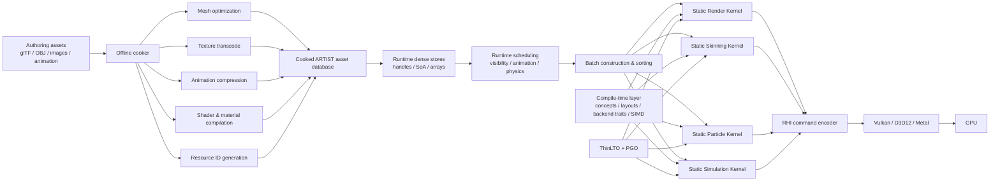
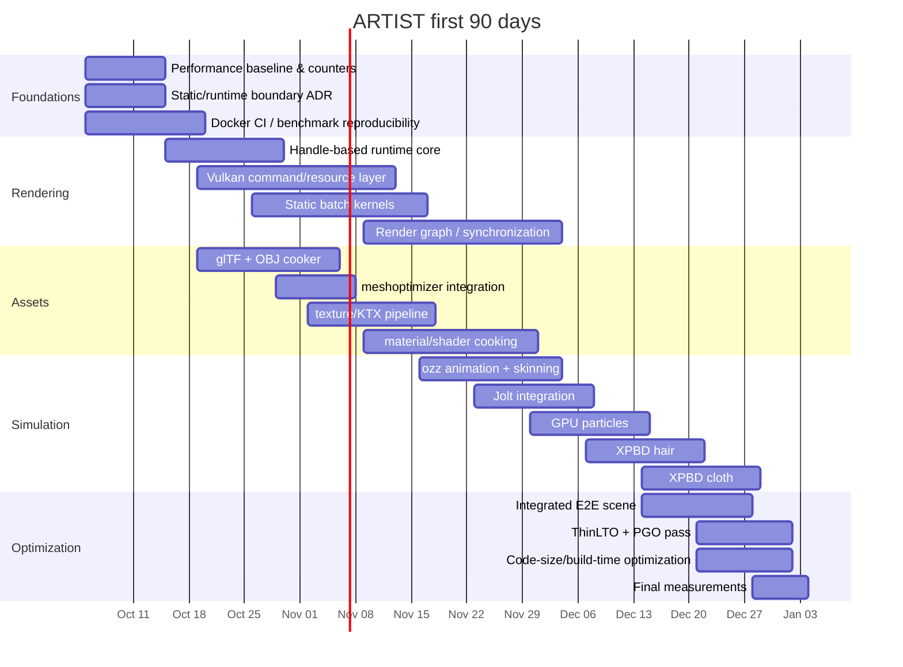
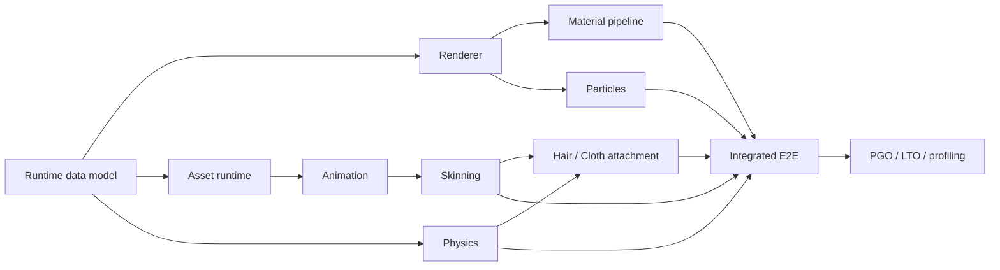

# Static-First Without Static-Everything: An Architecture for Technical Excellence in ARTIST

## Executive Summary

The central conclusion is **not** that ARTIST's static-first philosophy is misguided. It is that the philosophy should be made more precise.

ARTIST explicitly describes itself as a low-level C++ rendering toolkit built around templates, metaprogramming, composition, API/profile specialization, and compile-time validation of rendering pipeline components. That is a coherent performance-oriented direction. fileciteturn6file0L2-L2 The problem is that the current implementation often obtains compile-time knowledge and then crosses back into runtime-erased object graphs: `IPipeline<API>`, `IPass<API>`, `IShader<API>`, virtual methods, `std::shared_ptr`, vectors of interface pointers, and string-keyed `unordered_map`s coexist with `if constexpr`, concepts, and `PROFILE` template parameters. fileciteturn4file0L2-L2 fileciteturn5file0L2-L2

For the engine you are describing, I would preserve the ambition but redefine it as:

> **Resolve every decision as early as it is genuinely knowable, and no earlier.**

That produces four distinct binding times rather than the binary choice “static versus dynamic”:

| Binding time | What belongs there |
|---|---|
| **C++ compile time** | Closed-set algorithms, backend traits, vertex layouts, SIMD kernels, fixed structural composition, invariants, type contracts |
| **Link time** | Cross-TU inlining, devirtualization, dead stripping, code layout |
| **Cook time** | Mesh optimization, texture conversion, animation compression, shader permutations, reflection, material graphs, resource IDs, PSO descriptors |
| **Runtime** | Visibility, scene instances, contacts, animation state, particles, cloth/hair positions, streaming decisions, hardware/driver objects, scheduling |

This distinction matters because **cook-time computation is just as capable as template metaprogramming of removing runtime parsing, lookup, validation, string processing, graph construction, or permutation discovery**, while avoiding the combinatorial template-instantiation and binary-size costs of expressing every asset variation as a C++ type.

The ideal ARTIST runtime is therefore not a conventional virtual-object engine. Nor is it a giant C++ type expression representing the entire game. It is:

> **static kernels + cooked data + runtime batches + coarse-grained dispatch.**

That architecture retains exactly the properties you are after: predictable hot loops, contiguous data, specialization where specialization wins, vectorization opportunities, fewer unpredictable indirect branches, low runtime setup work, explicit GPU scheduling, and no string/pointer-heavy traversal in frame-critical paths.

The key qualification is that **“no function calls” is not itself the target metric**. Modern compilers already perform devirtualization and speculative devirtualization when they can prove or predict targets, and LTO extends their visibility across translation units. GCC explicitly documents virtual-to-direct conversion and speculative devirtualization; LLVM ThinLTO provides scalable cross-module optimization and function importing. citeturn19view1turn18view0 A five-instruction inlined function that is duplicated into 200 specializations may be worse than one predictable direct call if the duplication worsens instruction-cache pressure. GCC itself warns that transformations such as loop unrolling enlarge code and “may or may not” improve execution time, while PGO uses measured branch and call frequencies to guide optimizations such as inlining. citeturn19view2turn19view0

So my recommendation is **more aggressively static than a mainstream general-purpose engine, but much less aggressively type-encoded than “everything is a template.”**

For your target—a technically excellent engine capable of loading common assets, animation, particles, rigid-body physics, visually convincing but non-photorealistic hair and cloth—I estimate:

| Target | Engineering effort |
|---|---:|
| First serious vertical slice using mature third-party physics/animation/import libraries | **12–18 person-months** |
| Coherent technically excellent engine with the requested systems, one primary graphics backend | **20–30 person-months** |
| Same with substantial custom physics/animation/cloth infrastructure | **35–50 person-months** |
| “I want to research and own almost every subsystem” | **50–75+ person-months** |

Those are **engineering estimates**, not vendor figures. A strong agentic harness should materially reduce mechanical implementation, test generation, refactors, glue code and investigation time, but it does not parallelize away architecture, profiler interpretation, GPU synchronization errors, integration debugging, or the dependency chain between renderer → assets → animation → skinning → physics → deformables. I would budget **roughly 18–30 months for one very strong human developer with agents**, or perhaps **8–12 calendar months for three senior developers plus agents** for the requested non-editor, PC-first scope. The first 90 days can absolutely produce an impressive end-to-end engine slice; they should not be expected to produce the finished engine.

My strongest concrete recommendation is therefore:

**Keep ARTIST static-first. Remove dynamic polymorphism from hot fine-grained rendering composition. But replace “compile everything into C++ types” with “compile algorithms; cook content; execute dense runtime data.”**

That is the version of your idea I believe can actually achieve the technical excellence you mean.

## ARTIST and the Correct Static–Dynamic Boundary

The most interesting part of the existing ARTIST design is that it already contains both sides of the architectural argument.

Your specialized `Pipeline<API, PROFILE>` is constrained by:

```cpp
requires(API::Validator::template validatePipeline<API, PROFILE>())
```

and inside the override it performs:

```cpp
if constexpr (
    graphic::validator::HasComponent<
        typename API::PipelineContext::User<PROFILE>
    >
) {
    API::PipelineContext::template User<PROFILE>::on(context);
}
```

That is a good use of static knowledge: the backend/profile combination and the existence of an implementation are closed-world facts. The compiler can remove nonexistent branches and reason about the exact selected component. fileciteturn4file0L2-L2

But the surrounding abstraction is:

```cpp
template <typename API>
class IPipeline {
public:
    virtual ~IPipeline() = default;

    virtual int getPassesCount() const;
    virtual bool useNext();
    virtual void use(const int& pass);
    virtual void reset();

protected:
    virtual void use(
        std::shared_ptr<typename API::PipelineContext>
    ) = 0;

private:
    std::shared_ptr<typename API::PipelineContext> m_context;
};
```

and `IPass` similarly owns a context, traverses `std::shared_ptr<IShader<API>>`, calls virtual methods on shaders, and exposes string-keyed maps of uniforms and attributes. fileciteturn4file0L2-L2 fileciteturn5file0L2-L2

So today ARTIST is conceptually:

```text
compile-time selection
        ↓
virtual interface
        ↓
shared_ptr
        ↓
context object
        ↓
vector / unordered_map
        ↓
more interface pointers
        ↓
static specialized component
```

That loses much of the value of having established a closed type at the top.

It does **not** mean every `virtual` keyword is inherently catastrophic. GCC can turn virtual calls into direct calls when enough information is visible, and speculative devirtualization can expose subsequent inlining opportunities. citeturn19view1 With LTO or ThinLTO, optimization can cross translation-unit boundaries that would otherwise obscure concrete types. citeturn18view0turn19view3

The stronger objection is architectural: **fine-grained pointer-based polymorphism makes the exact execution topology harder for both the CPU and the compiler to see.** You create more dependent loads before useful work can begin, ownership semantics invade hot data, object allocation tends to scatter logically adjacent state, and string/hash lookup becomes part of paths that could have been represented by compact numeric IDs. That is particularly unfortunate in an engine whose stated purpose is compile-time pipeline resolution. ARTIST's current `IPass::load()`, for example, iterates through interface pointers and invokes each shader through the interface before invoking its own profile-specialized operations. fileciteturn5file0L2-L2

The architecture I would move toward is this:



This deliberately moves ARTIST's dynamic/static boundary **outward**. Instead of one virtual decision per pass/shader/entity, runtime decides which *batch* needs which precompiled kernel. A batch can contain hundreds or thousands of instances.

For example:

```cpp
using ExecuteFn =
    void (*)(CommandContext&, std::span<const DrawPacket>) noexcept;

struct CookedPipeline {
    ExecuteFn execute;
    PipelineHandle native_pso;
    ResourceLayoutId resource_layout;
};

for (const RenderBatch& batch : frame.batches) {
    const CookedPipeline& p = pipelines[batch.pipeline_id];
    p.execute(cmd, batch.draws); // one indirect dispatch per batch
}
```

One indirect call per large batch is profoundly different from virtual dispatch repeatedly at object → pass → shader → attribute → uniform granularity. The former is usually trivial to amortize; inside `execute`, the entire loop is monomorphic.

For a truly closed configuration, retain your fully static form:

```cpp
template<class... Stages>
class StaticPipeline {
public:
    ARTIST_ALWAYS_INLINE
    void execute(FrameContext& frame) noexcept {
        std::apply(
            [&](auto&... stages) {
                (stages.execute(frame), ...);
            },
            stages_
        );
    }

private:
    [[no_unique_address]] std::tuple<Stages...> stages_;
};
```

But **do not instantiate this for every material, object, texture combination, or animation state**. Instantiate it for a small, deliberately bounded family of algorithmic configurations.

That distinction can be stated very precisely:

| Question | Static if… | Runtime/data-driven if… |
|---|---|---|
| Which implementation exists? | Known when engine is built | Plugin/hot-reload requirement |
| Which vertex representation is processed? | Small closed set | User-defined arbitrary streams |
| Which backend algorithm is compiled? | Backend binary is known | One binary switches backends dynamically |
| Which entity is visible? | Never | Always runtime |
| Which animation clip is playing? | Never | Always runtime |
| Which shader family is used? | Small finite families | Material content varies |
| Which material parameters are bound? | Layout may be static | Values are runtime data |
| Which resource goes in slot X? | Slot semantics may be static | Resource identity is runtime |
| Which physics bodies touch? | Never | Runtime solver state |
| Solver algorithm | Can be static | Solver inputs/results are runtime |
| Hair strand count and positions | Never | Runtime data |
| Hair constraint type/kernel | Good static candidate | Data selects which batches need it |

This is what I mean by **static-first rather than static-everything**.

There is an additional GPU-side reason not to encode the full world in C++ templates. Explicit graphics APIs already have their own pipeline specialization boundary. Direct3D 12, for example, groups most fixed graphics state into Pipeline State Objects specifically so dependent state can be preprocessed before frame-time switching; command lists then bind PSOs and resources while recording work. citeturn12view0turn12view1 Vulkan similarly exposes command queues, synchronization and pipeline caches; command submissions can proceed independently subject to explicit synchronization, and pipeline creation/caching remains an API/driver concern. citeturn18view3turn18view4

So C++ compile-time flattening **cannot eliminate the genuinely runtime GPU objects or synchronization problem**. It can make the CPU code that produces those objects and commands excellent.

That should be the objective.

## Subsystem Decisions, Feature Split, and Engineering Effort

The estimates below assume one expert-level C++/graphics engineer, assisted by a strong agent harness, with a PC-first Vulkan implementation, no full editor, no networking/gameplay framework, and a deliberate willingness to adopt mature libraries where reinventing the subsystem does not further ARTIST's core research objective. A “person-month” here means roughly one senior engineer-month of focused work; agent assistance is already reflected modestly in the lower bounds.

**The labels mean:**

- **Static**: algorithm topology/type choice should be compile-time specialized.
- **Data-driven**: descriptions are cooked/generated but consumed as compact runtime data.
- **Dynamic**: the state is inherently runtime and should be represented efficiently rather than templated away.
- Most real systems are deliberately hybrid.

| Subsystem | Recommended binding | Microarchitectural reasoning | Developer cost | Estimate | Risk |
|---|---|---|---|---:|---|
| RHI/backend leaf operations | **Static-heavy hybrid** | Backend and many resource/layout operations form a closed set; static specialization removes fine-grained abstraction. Device state remains runtime. Explicit APIs already encode command/PSO state. citeturn12view0turn18view3 | High | 4–7 PM Vulkan-first | High |
| Render pipeline families | **Static** | Ideal location for compile-time stage composition and inlining. Keep number of families bounded. | Med–High | 2–3 PM | Medium |
| Render graph | **Data-driven/runtime** | Dependencies depend on enabled effects/resources/frame configuration; graph compilation can generate a compact execution schedule. | High | 2–4 PM | High |
| Draw dispatch | **Runtime batches → static kernels** | Sorting/grouping transforms many unpredictable per-object decisions into few coarse dispatches. | Medium | 1–2 PM | Low–Med |
| Material definitions | **Cook-time data** | Encoding every material permutation in C++ causes combinatorial type growth; compile shader/material graph offline and resolve IDs beforehand. Filament similarly ships a host-side material compiler rather than making C++ templates the asset language. citeturn20view1 | High | 2–4 PM | Medium |
| Shader permutation kernels | **Static/cook-time** | Specialize only parameters that materially remove shader/CPU work; ordinary values stay uniforms/buffers. | High | included above | High |
| Resource handles | **Dynamic, data-oriented** | Resources are created/destroyed at runtime; dense integer/generational handles avoid pointer graphs. | Medium | 1.5–3 PM | Medium |
| Uniform/resource names | **Cook-time only** | Strings useful for tooling/reflection but should resolve to offsets/IDs before hot runtime loops. | Low–Med | 0.5–1 PM | Low |
| Vertex layout taxonomy | **Static** | Small set of layouts benefits from exact stride/format knowledge, SIMD and shader matching. | Low–Med | 0.5–1 PM | Low |
| Mesh instances | **Dynamic SoA/arrays** | Transform/visibility/LOD change every frame; contiguous runtime data is more valuable than type identity. | Medium | 1–2 PM | Medium |
| Mesh preprocessing | **Cook-time** | Cache/fetch/meshlet optimization is naturally offline. Meshoptimizer explicitly targets vertex-cache/fetch locality and GPU-oriented clustering. citeturn17view0 | Low–Med | 0.5–1 PM integration | Low |
| OBJ/glTF/etc. parsing | **Offline dynamic importer** | Parsing arbitrary external formats has no frame-time value; normalize once into ARTIST's format. Assimp supports 40+ formats; glTF exists specifically as a runtime asset-delivery format. citeturn20view0turn20view3 | Medium | 1–2 PM | Low |
| Runtime mesh format | **Cooked data** | Fixed compact layout, direct ranges/offsets and ready-to-upload payloads beat retaining generic importer objects. | Medium | 1–2 PM | Medium |
| Texture decode/import | **Cook-time** | Decode, mip generation and compression are not frame-loop work; Khronos KTX tooling exists specifically around deployable texture payloads. citeturn17view3 | Medium | 1–2 PM | Low |
| Texture residency/streaming | **Dynamic** | Visibility and memory pressure are runtime phenomena. | High if streaming | 1 PM basic / 3–6 streaming | High |
| Skeleton topology schema | **Cooked/static-ish** | Joint hierarchy is immutable per skeleton asset after import. | Low | included animation | Low |
| Animation clips | **Cooked data** | Clip samples and compressed tracks are content, not C++ types. Ozz explicitly separates offline processing and cache-friendly runtime animation. citeturn16view3 | Medium | 2–4 PM with Ozz | Low–Med |
| Sampling/blending kernel | **Static** | Excellent SIMD specialization point; hot arithmetic over predictable SoA buffers. Ozz is explicitly designed around cache-friendly SIMD/SoA execution. citeturn16view3 | Medium | included | Medium |
| Animation state machine | **Data-driven/runtime** | State transitions depend on gameplay/time; encode state graph as cooked data. | Medium | 1–2 PM | Medium |
| CPU skinning | **Static SIMD kernels** | Layout/influence-count specialization benefits vectorization; choose a bounded kernel set. | Medium | 1–2 PM | Medium |
| GPU skinning | **Static shader families + runtime buffers** | Bone matrices and vertices are runtime arrays; shader topology can be specialized. | Medium | 1–2 PM | Medium |
| Particles | **Dynamic GPU data + static kernels** | Particle values/counts change continuously, while update operator families are finite. | Medium | 2–4 PM | Medium |
| Physics API integration | **Dynamic state + static adapter** | Contacts/islands/bodies are inherently dynamic. Attempting type-level world representation has no benefit. Mature solvers already optimize this domain extensively. citeturn16view0turn16view1 | Medium | 2–4 PM | Medium |
| Own rigid-body solver | **Static math + runtime solver data** | Collision algorithms can be statically specialized; broadphase/contact graphs cannot. | Very high | 18–30+ PM | Very high |
| Job system | **Runtime scheduler + static job bodies** | Dependencies and workload fluctuate; functions themselves should be monomorphic and data-oriented. | High | 2–4 PM | High |
| Cloth | **Dynamic arrays + static XPBD/PBD kernels** | Vertex positions/constraints are runtime; constraint equations are excellent compile-time kernel candidates. XPBD was specifically proposed to improve timestep/iteration behavior over traditional PBD. citeturn11search8turn11search31 | Med–High | 3–5 PM basic | Medium |
| Hair | **Dynamic strands + static solver/render kernels** | Same pattern as cloth; strand topology and current coordinates are data. AMD TressFX demonstrates GPU simulation/rendering of hair/fur as a practical architecture. citeturn13search6 | High | 2–4 PM basic | Med–High |
| Serialization | **Generated schema/cooked blobs** | Build-time schema generation gives typed access without making every asset a C++ template instance. FlatBuffers supports direct serialized-data access and schema evolution. citeturn14search0turn14search4turn14search24 | Low–Med | 1–2 PM | Low |
| ECS/scene database | **Dynamic SoA/archetypes** | Entity populations and components are runtime facts; cache locality matters more than static identity. | Med–High | 2–4 PM | Medium |
| Debug/editor reflection | **Dynamic/cooked metadata** | Keep names and introspection in cold/debug paths rather than rendering inner loops. | Medium | 1–3 PM basic | Low |

The **feature-specific split** is therefore particularly clear.

**Meshes and OBJ/glTF.** Import dynamically in a standalone cooker. Use fastgltf/cgltf for first-class glTF support or Assimp as a broad compatibility front end, then throw the importer representation away. Assimp's purpose is precisely to normalize many external formats into a common in-memory structure, while fastgltf is a C++ glTF implementation focused on speed and modern integration. citeturn20view0turn17view1 Run geometry through meshoptimizer offline, generate the exact ARTIST GPU streams/meshlets/indices you want, and load only that format at game runtime. Meshoptimizer documents cache, overdraw, vertex-fetch and cluster/meshlet optimization as part of its intended pipeline. citeturn17view0

**Textures.** Treat PNG/JPEG/TGA/etc. as source formats, not runtime formats. Cook them to KTX2/appropriate block-compressed targets, generate mips offline, and make the runtime path roughly “read header → reserve/upload → descriptor.” Khronos maintains KTX tooling for this purpose. citeturn17view3 Texture *identity* and residency remain dynamic; the transcoding pipeline does not.

**Animation.** Skeleton and compressed tracks are cooked data. Sampling, blending, local-to-model transformation and skinning are kernels. This is almost the textbook case for the static/data split: Ozz is engine-agnostic, uses an offline toolchain, and structures its runtime for cache/SIMD-friendly animation work. citeturn16view3 Do not turn every animation clip or state node into a unique C++ template type.

**Particles.** Define a small operator vocabulary—spawn, gravity, drag, curl/noise, attractor, collision, kill—then cook emitter graphs into either an opcode schedule or a selected compute-kernel family. Positions, velocities, ages and alive lists are GPU data. You can template the kernels over genuinely performance-significant features, but runtime values remain buffers.

A good decomposition is:

```cpp
template<bool Collision, bool CurlNoise, bool Trails>
struct ParticleKernel {
    static void dispatch(
        GpuCommandContext& cmd,
        const ParticleBuffers& buffers,
        const EmitterParams& params);
};
```

Not:

```cpp
template<
    float Gravity,
    float Drag,
    std::size_t MaxParticles,
    auto Texture,
    auto SpawnCurve,
    ...
>
struct ParticleEmitter;
```

The first creates a bounded number of meaningful machine-code variants. The second makes content changes trigger C++ builds.

**Physics.** The world is intrinsically runtime data: bodies wake and sleep, broadphase membership changes, contact manifolds appear/disappear, constraint islands change. Jolt describes explicit facilities for concurrent queries/updates and multi-core simulation, while PhysX is a mature real-time physics SDK. citeturn16view0turn16view1 Static specialization belongs *inside* shape/math/narrow-phase kernels or the ARTIST adapter—not in representing “this world contains a `Box<...>` and `Sphere<...>`” in the type system.

**Hair and cloth.** For your “looks convincing, not research-grade photorealism” requirement, position-based methods are an unusually good fit. PBD is explicitly attractive in games and visual simulation where plausible behavior matters more than force accuracy, and XPBD improves compliance behavior with respect to timestep and solver iterations. citeturn11search31turn11search8 A cloth mesh can therefore be arrays of positions, previous positions, inverse masses and constraint records, with templated/vectorized solver kernels. Hair can use guide strands, distance/bending constraints and scalp/collider coupling; AMD's TressFX is useful as a reference because it combines GPU hair simulation/rendering, skinning and LOD in an open implementation. citeturn13search6

A minimal XPBD-style architectural pattern is:

```cpp
struct DistanceConstraint {
    uint32_t a;
    uint32_t b;
    float rest_length;
    float compliance;
    float lambda;
};

template<int Iterations, bool UseSIMD>
void solve_distance_constraints(
    std::span<Vec3> x,
    std::span<const float> inverse_mass,
    std::span<DistanceConstraint> constraints,
    float dt) noexcept
{
    for (int iteration = 0; iteration < Iterations; ++iteration) {
        // Batch constraints by non-conflicting color.
        // Run a vectorized constraint kernel over each batch.
    }
}
```

Here `Iterations` may be a compile-time specialization **only if profiling shows a stable small set of iteration counts**. Positions, constraints and stiffness do not need to become template parameters.

## C++ Techniques for an Aggressively Static Engine

The right use of modern C++ in ARTIST is to use the language as a **partial evaluator and contract system**, not as the serialization format for your universe.

**Templates should specialize algorithmic structure.** Good parameters are `Backend`, `VertexLayout`, `SkinningMode`, `PassKind`, SIMD width, optional algorithmic features and other bounded choices whose values materially change generated instructions.

For example:

```cpp
template<class T>
concept GraphicsBackend =
    requires(T backend,
             CommandBuffer& cmd,
             const PipelineDesc& desc)
{
    { backend.create_pipeline(desc) } -> std::same_as<PipelineHandle>;
    { backend.submit(cmd) } noexcept;
};

template<
    GraphicsBackend Backend,
    class Layout,
    ShadingPath Path
>
struct DrawKernel final {
    static void execute(
        Backend& backend,
        CommandBuffer& cmd,
        std::span<const DrawPacket> packets) noexcept
    {
        // Backend, vertex layout and shading path are compile-time known.
        // packets are runtime contiguous data.
        for (const DrawPacket& p : packets) {
            // hot monomorphic loop
        }
    }
};
```

Concepts are especially valuable here because they let you preserve ARTIST's compile-time component validation while improving diagnostics. They should be understood primarily as **correctness/API-constraint machinery**, not as a performance optimization by themselves. ARTIST already uses this principle through its validator requirements. fileciteturn4file0L2-L2

**`constexpr` is appropriate for values; `consteval` is appropriate for invariants that must exist before runtime.** Suitable uses include vertex-layout derivation, descriptor-layout generation, stable type/resource IDs, format mappings, lookup tables, compile-time state-machine validation, or static calculation of resource compatibility.

```cpp
struct AttributeDesc {
    Semantic semantic;
    Format format;
    uint16_t offset;
};

template<class Vertex>
consteval auto vertex_layout();

constexpr uint64_t hash_literal(std::string_view s) noexcept
{
    uint64_t h = 1469598103934665603ull;
    for (char c : s) {
        h ^= static_cast<unsigned char>(c);
        h *= 1099511628211ull;
    }
    return h;
}

inline constexpr auto kPositionId = hash_literal("POSITION");
```

But avoid “compile-time asset loading” as a goal. Parsing thousands of meshes or compiling a huge material library through C++ constant evaluation merely moves an asset build into the least scalable and least observable part of your C++ build system. The correct mechanism is usually **code generation or an asset cooker**.

That is an important distinction:

```text
Bad interpretation of static-first:
asset change
  -> instantiate templates
  -> compile C++
  -> link executable

Better interpretation:
asset change
  -> cook asset
  -> engine binary unchanged
  -> load binary-ready data
```

Filament offers a useful industry reference: it ships host-side tools—including its material compiler—to generate assets for the runtime rather than representing all material content as C++ compile-time types. citeturn20view1

**Explicit instantiation is essential** once template use grows. Public headers can declare generic templates while selected instantiations live in dedicated translation units:

```cpp
// draw_kernel.hpp
template<class Backend, class Layout, ShadingPath Path>
struct DrawKernel;

// vulkan_draw_kernels.cpp
template struct DrawKernel<VulkanBackend, PNTVertex, ShadingPath::Forward>;
template struct DrawKernel<VulkanBackend, SkinnedPNTVertex, ShadingPath::Forward>;
template struct DrawKernel<VulkanBackend, PNTVertex, ShadingPath::DepthOnly>;
```

That gives you control over exactly which machine-code variants exist instead of accidentally instantiating combinations across unrelated translation units.

**Do not use CRTP merely because it is “static.”** CRTP is valuable when it makes a closed abstraction zero-overhead:

```cpp
template<class Derived>
class EncoderBase {
public:
    void draw(const DrawArgs& args) noexcept {
        static_cast<Derived&>(*this).draw_impl(args);
    }
};
```

But if 30 derived encoders each instantiate 40 substantial base methods, you have traded an indirect call for code duplication. Measure `.text` growth.

**`std::variant` is useful for genuinely closed runtime sets.** It keeps the alternative set explicit and can expose types to `std::visit`:

```cpp
using Backend =
    std::variant<VulkanBackend, D3D12Backend, MetalBackend>;
```

But it is not magic. Per-object `visit()` still introduces a runtime alternative selection and may instantiate the visitor for every alternative. Use it at coarse boundaries—device/backend selection—not as a replacement for every virtual component.

**Type erasure is acceptable when it is amortized.** A single function pointer at a subsystem or batch boundary can be a cleaner and faster architecture than huge template graphs:

```cpp
struct Kernel {
    using Fn = void(*)(
        CommandContext&,
        std::span<const DrawPacket>) noexcept;

    Fn fn;
};

template<class Impl>
consteval Kernel erase_kernel() {
    return {
        .fn = +[](CommandContext& c,
                  std::span<const DrawPacket> p) noexcept {
            Impl::execute(c, p);
        }
    };
}
```

What you want to avoid is **recursive type erasure**:

```cpp
shared_ptr<IPipeline>
 -> shared_ptr<IPass>
   -> shared_ptr<IShader>
     -> shared_ptr<IAttribute>
```

particularly when traversal occurs during frame work. ARTIST currently contains multiple levels of this pattern. fileciteturn3file0L1-L16 fileciteturn3file1L17-L31 fileciteturn3file2L33-L47

**LTO is part of the architecture, not an afterthought.** ThinLTO provides cross-module importing and whole-program analysis while keeping backend optimization parallel and supporting incremental caches. citeturn18view0 Full LTO can extract even more whole-program knowledge, but build time and memory are higher; GCC also notes toolchain/version constraints around its LTO representation. citeturn19view3

For ARTIST I would use:

```text
Debug:
  -O0/-Og
  sanitizers
  no LTO

Dev-performance:
  -O2
  ThinLTO optional/incremental
  optimization remarks enabled

Release-profile:
  -O3 (or benchmark O2 vs O3)
  ThinLTO/full LTO benchmarked
  instrumentation or sampling profile

Release-final:
  profile-use
  ThinLTO/full LTO
  section GC
  stripped symbols in shipping artifact
```

**PGO is perhaps more philosophically important than more TMP.** Compile-time metaprogramming knows what *can* happen; PGO tells the compiler what *actually happens frequently*. Clang explicitly uses profile information to improve basic-block ordering and inliner choices according to measured branch/function frequencies. citeturn19view0 GCC's profile-guided optimization similarly enables transformations such as cloning and loop optimizations, while warning that some transformations increase code size. citeturn19view2

That suggests a performance hierarchy:

```text
First:    choose good data organization and algorithms
Second:   eliminate needless runtime work at cook/compile time
Third:    batch work so branches/dispatch are coarse
Fourth:   specialize important kernels
Fifth:    let LTO see across abstraction boundaries
Sixth:    let PGO tell the optimizer what is actually hot
Seventh:  hand-force inlining/specialization only with measurements
```

This is more technically rigorous than “template everything.”

**Forced inlining should be exceptional.**

An anti-pattern is:

```cpp
#define ARTIST_FORCE_INLINE [[gnu::always_inline]] inline
```

applied broadly to an engine's abstraction layer. The compiler has much more context after LTO/PGO than a source-level macro does, and indiscriminate duplication competes for instruction-cache capacity. GCC explicitly documents optimizations that clone/unroll code and notes that increased code size does not necessarily increase speed. citeturn19view2

I would reserve forced inlining for tiny, measured leaf operations where:

1. the call survives release LTO;
2. profiling shows it is hot;
3. the body is tiny;
4. assembly inspection confirms the desired effect;
5. `.text` and instruction-cache counters do not regress.

**Make optimization observability part of CI.** Clang exposes optimization-record support and profile-guided facilities, while ThinLTO supports incremental caching and parallel backends. citeturn18view0turn18view1 For each representative scene, record at minimum:

```text
CPU:
  frame CPU time
  render submission CPU time
  instructions retired
  cycles
  IPC
  branch misses
  LLC misses
  allocator traffic
  job wait time

Binary/compiler:
  .text size
  template-instantiation count where measurable
  clean build duration
  incremental build duration
  peak compiler/linker RAM
  inlining/devirtualization remarks

GPU:
  GPU frame time
  queue idle/bubbles
  pass timings
  barriers
  command-buffer count
  draw/dispatch count
  PSO changes
  descriptor changes
```

The critical discipline is to compare **static specialization against a deliberately optimized runtime implementation**, rather than against an obviously inefficient virtual baseline.

A fair experiment might therefore benchmark:

```text
A: virtual call per object
B: function pointer per object
C: variant/visit per object
D: function pointer once per batch
E: fully templated static batch
F: D + ThinLTO + PGO
G: E + ThinLTO + PGO
```

I would not be surprised if D/F gets extremely close to E/G in many real workloads, because once the indirect decision is moved outside the inner loop there is little abstraction cost left to eliminate. That is a hypothesis to benchmark, not a universal performance claim.

## Build Versus Buy

The correct build-vs-buy criterion for this project is unusual. You are not optimizing for product-market speed. You explicitly want to experience engine construction and pursue technical excellence. Therefore:

> **Buy/adopt things whose internals are not central to the experiment; build the systems whose architecture is the experiment.**

For ARTIST, the renderer, data architecture, scheduling boundaries, batching, synchronization, GPU resource model and static/cooked/runtime binding philosophy **are** the experiment. File-format parsers generally are not.

| Component | Candidate | License/status | Performance/architecture fit | Static-first suitability | Integration estimate | Recommendation |
|---|---|---|---|---|---:|---|
| Rigid-body physics | **Jolt Physics** | MIT. Jolt describes itself as multi-core-friendly; no RTTI/exceptions; SIMD options are documented. citeturn16view0 | Excellent fit for a performance-focused game engine; concurrency is a stated design goal. | **High** behind a thin ARTIST adapter | 2–4 PM | **Preferred default** |
| Rigid-body physics | **PhysX** | BSD-3-Clause; NVIDIA currently publishes the real-time PhysX SDK in source. citeturn16view1 | Mature broad simulation stack; larger integration surface. | Medium–High | 2–5 PM | Strong alternative |
| Rigid-body physics | **Bullet** | Open-source Bullet SDK; real-time collision/multi-physics focus. citeturn16view2 | Broad and proven; less aligned than Jolt with the specific “modern data-oriented engine” aesthetic I would pursue. | Medium | 2–4 PM | Good compatibility choice |
| Rigid-body physics | **Havok** | Commercial middleware; Havok markets Physics/Navigation/Cloth integration for proprietary game engines. citeturn14search6 | Attractive where vendor/platform support matters more than source-level research. | Medium | Commercial-dependent | Not first choice for ARTIST research |
| Animation | **ozz-animation** | Open-source; engine-agnostic skeletal animation/toolset. citeturn16view3 | Explicit cache/SIMD-oriented runtime/offline split. | **Very high** | 2–4 PM | **Strongly recommended** |
| Skinning | Ozz + custom GPU skinning | Same as above | Ozz handles skeleton/animation side; your GPU skinning remains an excellent ARTIST kernel. | **Very high** | 1–2 PM after animation | Recommended |
| General math | **Eigen** | MPL2 since 3.1.1; template linear-algebra library. citeturn13search1turn13search5 | Excellent numerical/tooling library; template-heavy itself. For engine hot types, alignment/layout and compile-time cost deserve careful control. | High for tools/solvers; medium for core ABI | 0.5–1 PM | Use selectively |
| Broad asset import | **Assimp** | Modified BSD 3-clause; imports 40+ formats and supplies post-processing. citeturn20view0 | Great offline compatibility layer; unnecessary genericity at runtime. | **High if cooker-only** | 1–2 PM | Recommended offline |
| glTF | **fastgltf** | Modern C++ glTF implementation focused on speed/correctness/usability. citeturn17view1 | Closer to modern C++ and a focused format than Assimp. | **High** | 0.5–1 PM | Preferred glTF front end |
| glTF | **cgltf** | Single-file C99 glTF 2.0 loader/writer. citeturn17view2 | Tiny integration surface; excellent if minimalism dominates. | High | 0.5 PM | Excellent alternative |
| Mesh cooker | **meshoptimizer** | MIT; focuses on making meshes smaller/faster to render and supplies cache/fetch/meshlet operations. citeturn17view0 | Almost exactly the kind of work that belongs at cook time. | **Very high** | 0.5–1 PM | **Use it** |
| Texture pipeline | **KTX-Software** | Khronos-maintained KTX library/tools. citeturn17view3 | Good cooked texture path; separates authoring formats from runtime payload. | High | 1 PM | Recommended |
| Hair | **AMD TressFX** | Open-source MIT; GPU hair/fur simulation and rendering. citeturn13search6 | Valuable reference or donor architecture; full adoption may dictate too much of your renderer. | Medium | 2–5 PM | Study/reference first |
| Cloth | **NvCloth** | Low-level realtime cloth solver in NVIDIA GameWorks repository, but NVIDIA has stated it is deprecated/no longer developed in favor of newer PhysX cloth technology. citeturn13search7turn13search22 | Historically useful but poor foundation for a new long-lived engine. | Medium | 2–4 PM | **Do not start new architecture on it** |
| Hair/cloth core | **Custom XPBD/PBD** | Your code | Very good fit for approximate game secondary motion and for your educational objective. Original XPBD work addresses timestep/iteration-dependent stiffness issues. citeturn11search8turn11search31 | **Very high** | Hair 2–4 PM; cloth 3–5 PM | **Build basic version** |
| Serialization | **FlatBuffers** | Apache 2.0; direct serialized-data access and schema evolution. citeturn14search0turn14search4 | Good for metadata/manifests; may still be more generic than optimal GPU payloads. | High | 1–2 PM | Good hybrid choice |
| Cross-API renderer | **bgfx** | Cross-platform, API-agnostic “bring your own engine/framework” rendering library. citeturn20view2 | Solves much of the backend problem you actually want to study. | Medium | 2–4 PM | Benchmark/reference, **not core ARTIST** |
| Full renderer | **Filament** | Apache-2.0, real-time PBR renderer; supports Metal/Vulkan/OpenGL/WebGPU and uses host asset/material tools. citeturn20view1 | Technically strong but replaces too much of ARTIST's research surface. | Medium | 3–6 PM | Reference/baseline, not foundation |
| Native backend | **Vulkan** | Explicit cross-platform graphics API with queues, synchronization and pipeline mechanisms. citeturn18view3turn18view4 | Maximum control and good match for your objective. | **Very high** | 4–7 PM first backend | **Start here** |
| Native backend | **D3D12** | Explicit PSO and command-list model. citeturn12view0turn12view1 | Excellent Windows backend and a useful test of RHI abstraction quality. | **Very high** | +2–4 PM | Second backend |
| Native backend | **Metal** | Apple native explicit graphics API; render-pipeline objects are a core API abstraction. citeturn12view2 | Necessary for native Apple support; different ecosystem/tooling increases port cost. | High | +2–4 PM | Later unless Apple is priority |

This leads to a fairly opinionated stack:

```text
Build yourself:
    ARTIST runtime architecture
    RHI / render scheduling
    batching
    resource handles
    shader/material cooking architecture
    GPU submission
    GPU skinning
    particle system
    simple XPBD hair/cloth
    performance harness
    asset runtime format

Adopt:
    Jolt
    ozz-animation
    fastgltf
    Assimp only for compatibility import
    meshoptimizer
    KTX tooling
    FlatBuffers or equivalent for metadata

Study but do not base ARTIST on:
    Filament
    bgfx
    TressFX

Do not reinvent initially:
    full production rigid-body physics
    forty file parsers
    animation compression ecosystem
    image codecs
```

There is a particularly interesting 2026 development for your hair/cloth question: the current Jolt repository now documents both soft-body support—including cloth-oriented constraints—and a GPU strand hair simulation based on rod constraints. citeturn16view0 That means Jolt is worth evaluating not only as rigid-body middleware but also as a **reference baseline** against your own simple secondary-motion implementation. I would still build a bounded XPBD hair/cloth layer if the purpose is learning and architecture research, but you no longer have to build it without a comparison point.

The key static-first integration rule for any third-party library is this:

```cpp
// Bad: leak middleware object model throughout engine
JPH::Body* body;
JPH::Shape* shape;
// everywhere...

// Better:
struct PhysicsBodyHandle {
    uint32_t index;
    uint32_t generation;
};

class PhysicsWorld {
public:
    PhysicsBodyHandle create(const BodyDesc&);
    Transform transform(PhysicsBodyHandle) const noexcept;
    void apply_impulse(PhysicsBodyHandle, Vec3) noexcept;
};
```

The engine owns its data contracts. Middleware is an implementation detail. That keeps replacement possible and stops a runtime-heavy third-party API from contaminating ARTIST's core hot-path architecture.

## Roadmap, Vertical-Slice E2E, and Cost Model

The first 90 days should not be organized as “implement all engine features.” They should answer one question:

> **Can ARTIST's static-kernel/cooked-data/runtime-batch architecture demonstrably outperform and out-scale the current pointer-oriented design while remaining usable?**

Assume a start date of Monday, **October 5, 2026**.



With one human engineer, those bars are **not independent full-time assignments**; they show overlapping agent work, test development and investigation. Human attention should follow the critical path.

The build constraint you supplied—**one Rust/C++ build at a time in Docker**—is actually useful here. Template-heavy C++ clean builds can create enormous CPU/RAM spikes, so serializing heavyweight builds while agents concurrently perform source analysis, write tests, inspect compiler output and prepare changes prevents the harness from benchmarking the machine's scheduler instead of the engine. ThinLTO supports parallel backend work and incremental caches, so release builds can still exploit the build host internally under controlled conditions. citeturn18view0

A milestone plan:

| Period | Deliverable | Acceptance test |
|---|---|---|
| Days 1–14 | Baseline current ARTIST architecture | Capture CPU instructions, cycles, branch misses, cache misses, `.text`, build time, GPU frame timings on fixed scenes |
| Days 15–30 | Handle-based runtime + first static draw batch | Same visual output; no `shared_ptr`/virtual traversal in inner draw batch; assembly confirms concrete kernel |
| Days 25–45 | Cooker + glTF/OBJ + texture pipeline | Source asset converts to deterministic ARTIST package; runtime never invokes Assimp/fastgltf |
| Days 35–55 | Material/shader cooking + Vulkan PSOs | Runtime binds cooked IDs; no runtime string lookup during steady-state draws |
| Days 45–65 | Animation and skinning | Load animated glTF, sample/blend skeleton, skin mesh; deterministic pose tests |
| Days 50–70 | Jolt rigid-body integration | Falling/stacking objects produce bounded deterministic/expected results on fixed build |
| Days 60–78 | GPU particles | 100k+ particle stress scene or hardware-calibrated target with no CPU-per-particle loop |
| Days 65–82 | Hair | Character head with guide-strand secondary motion, collision, no NaNs/explosions |
| Days 72–86 | Cloth | Cape/skirt patch with pinned vertices, gravity, character collider response |
| Days 80–90 | Release optimization | ThinLTO/PGO benchmark, code-size report, integrated one-command E2E passes |

The exact particle count is a **benchmark target, not a universal performance guarantee**; scale it to your reference GPU.

Your “Kind-like E2E analog” should be a first-class executable/script, not a collection of unit tests:

```text
artist-e2e
    |
    +-- cook source assets
    |     +-- OBJ
    |     +-- glTF + skeleton + clip
    |     +-- textures
    |
    +-- validate cooked package
    |
    +-- launch deterministic showcase scene
    |     +-- static mesh
    |     +-- skinned animated character
    |     +-- rigid bodies
    |     +-- particle emitter
    |     +-- simulated hair
    |     +-- simulated cloth
    |
    +-- render N fixed frames
    |
    +-- emit:
          screenshot(s)
          performance.json
          simulation.json
          GPU validation log
          asset manifest hash
```

Its acceptance rules should be machine-readable:

```text
Asset:
  all source assets cook successfully
  no runtime source-format parsing
  deterministic package manifest

Render:
  zero validation-layer errors
  expected number of views/passes
  perceptual image comparison within threshold

Animation:
  selected bone transforms within epsilon at known timestamps
  no NaN/Inf
  blend result within epsilon

Physics:
  expected resting positions/contact counts within tolerance
  no tunneling in chosen CCD case

Particles:
  expected live-particle interval
  bounding volume within expected range
  no CPU particle-update fallback

Hair:
  root follows skeleton
  maximum stretch error below threshold
  no NaN/Inf
  collider penetration below tolerance

Cloth:
  pinned vertices remain constrained
  stretch/bend error below threshold
  collider penetration below tolerance

Performance:
  CPU and GPU timing metrics emitted
  regression gates compared against pinned hardware baseline
```

Do not use an exact framebuffer hash across unrelated GPUs as the principal image test. Driver, floating-point and rasterization differences can make byte-identical results unnecessarily brittle. Use structural numerical checks plus a tolerant perceptual/golden-image comparison per supported backend/device family.

**Parallelization is bounded.**

The work graph looks more like:



Agents can parallelize tests, importers, tool wrappers, documentation, benchmark instrumentation, shader variants, CI and independent code reviews. They cannot safely make three conflicting architectural changes to resource lifetime, render scheduling and frame ownership at once. Those are shared invariants.

For budgeting, I would use this breakdown:

| Scope | Adopt-libraries strategy | Mostly custom strategy |
|---|---:|---:|
| Core runtime/data model | 3–5 PM | 3–5 PM |
| Vulkan renderer/RHI/render graph | 6–10 PM | 6–10 PM |
| Asset cooker/formats/textures | 3–5 PM | 8–12 PM |
| Animation + skinning | 3–5 PM | 8–12 PM |
| Physics | 2–4 PM | 18–30+ PM |
| Particles | 2–4 PM | 2–4 PM |
| Hair + cloth | 5–8 PM | 10–18 PM |
| CI/perf/testing/toolchain | 2–4 PM | 2–4 PM |
| Integration/performance polish | 4–7 PM | 6–10 PM |
| **Total with overlap/reuse** | **20–30 PM** | **50–75+ PM** |

Again, these are my engineering estimates, not published project statistics.

For hardware, the engine does not require a render farm. Compile-time-heavy C++ does benefit strongly from a dedicated high-memory build machine.

A reasonable 2026 lab budget is approximately:

| Hardware | Suggested class | Budget estimate |
|---|---|---:|
| Primary development workstation | 16–32 fast CPU cores, 64–128 GB RAM, high-end Vulkan/D3D12 GPU, fast 2–4 TB NVMe | €3k–€6k |
| Build/CI node | 32–64 CPU cores, 128–256 GB RAM, 2–4 TB fast NVMe | €3k–€6k |
| Second GPU-vendor runner | Mid/high AMD or NVIDIA opposite primary vendor | €1k–€2.5k |
| Apple/Metal machine when needed | Apple Silicon development system | €1.5k–€4k |
| Storage/backup/test peripherals | NVMe/cache/backup | €500–€1.5k |
| **Useful lab total** | Depending on reuse of existing equipment | **roughly €7k–€20k** |

Those are intentionally broad **budgeting estimates**, not current retail quotations.

The important hardware expenditure for a template-heavy project may actually be the build node rather than a second flagship GPU. A 30-minute clean compile repeatedly interrupts architecture experimentation; a GPU that is 15% faster rarely does.

For compile-time and binary-size tradeoffs, avoid fake universal percentages. The combinatorial danger can nevertheless be quantified structurally.

If you independently template eight binary rendering options:

\[
2^8 = 256
\]

possible specializations.

Twelve independent binary options produce:

\[
2^{12} = 4096
\]

possible combinations.

The linker will remove uninstantiated ones and may merge identical code, but **the architectural explosion exists before optimization**. That is why a bounded set of named pipeline families is preferable to a Cartesian product of feature flags.

I would establish concrete project budgets:

| Metric | Initial engineering budget |
|---|---:|
| Ordinary incremental renderer build, p95 | **< 60–90 s** |
| Clean developer build | **< 8–12 min** |
| Full release + LTO/PGO link | **< 20–40 min** on build node |
| Static specialization `.text` growth over optimized erased baseline | **Prefer < 20–40%** |
| Automatic review threshold | **> 50% text growth unless ≥ ~2–3% measured hot-path gain** |
| Per-frame hot-path heap allocations after warmup | **0 target** |
| Runtime string/hash lookups in steady-state rendering | **0 target** |
| Virtual dispatches inside draw/particle/skinning inner loops | **0 target** |
| Coarse batch dispatch | **Allowed and expected** |

These are **recommended ARTIST policy thresholds**, not statements about what all engines achieve.

They give static metaprogramming a performance budget instead of ideological immunity.

## Risks, Failure Modes, and Final Recommendation

The greatest risk to ARTIST is not that templates are “too advanced.” It is that the project could optimize **source-level abstraction cost** while missing the much larger machine-level costs.

The first failure mode is **compile-time explosion**. Header-defined templates multiply parsing and instantiation work across translation units, and combinations multiply faster than feature count. ThinLTO exists precisely because whole-program optimization needs a scalable/incremental design rather than a monolithic approach; its cache and parallel backend support are valuable tools, but they cannot compensate for an unbounded type state space. citeturn18view0

Mitigation: bounded specialization sets, explicit instantiations, separate cooked content from executable code, modules/PCH where useful, and CI tracking build time per commit.

The second is **instruction-cache/code-size regression**. Eliminating a call is not free when it duplicates the callee at dozens of sites. GCC explicitly notes that profile-driven cloning can significantly increase code size and that unrolling makes code larger without guaranteeing greater speed. citeturn19view2

Mitigation: inspect `.text`, disassembly and hardware counters. Treat “function disappeared” as an intermediate observation, not proof of improvement.

The third is **mistaking virtual dispatch for the whole performance problem**. Compilers already devirtualize when possible, especially under favorable visibility, and speculative devirtualization can expose inlining. citeturn19view1 In ARTIST today, I would worry at least as much about `shared_ptr`-rich traversal, scattered contexts, runtime maps/strings and fine-grained object topology as about the virtual branch itself. fileciteturn4file0L2-L2 fileciteturn5file0L2-L2

Mitigation: benchmark four transformations independently—devirtualization, ownership removal, data compaction, and batching. You may discover that converting `vector<shared_ptr<IThing>>` into dense handles/SoA matters more than converting one remaining batch-level function pointer into a template.

The fourth is **compile-time semantic overfitting**. If every new shader/material/mesh combination becomes a C++ type, your executable becomes the asset database. That makes iteration, hot reload, modding, tooling and build distribution unnecessarily expensive.

Mitigation: make **cook-time a first-class member of static-first philosophy**. The runtime should see frozen layouts, IDs and optimized bytes, but the C++ compiler does not need to be the program that froze them. Filament's separate material/compiler tooling and glTF's runtime-delivery goal both illustrate this separation. citeturn20view1turn20view3

The fifth is **over-specializing against one CPU or one scene**. A specialization that removes a predictable branch may make the code larger enough to regress another workload. PGO is specifically useful because it supplies measured branch and function-frequency information to the optimizer rather than relying entirely on static heuristics. citeturn19view0

Mitigation: maintain at least three benchmark scenes: draw-call-heavy, geometry/animation-heavy, and simulation/particles-heavy. Do not approve architectural performance changes from one showcase scene.

The sixth is **GPU submission myopia**. A perfectly inlined CPU render loop can still perform badly if it creates excessive PSO switches, barriers, descriptors, command buffers, queue synchronization or GPU bubbles. Explicit APIs make these responsibilities visible: D3D12 deliberately uses preprocessed PSOs and command lists, while Vulkan queue ordering and synchronization are explicit. citeturn12view0turn12view1turn18view3

Mitigation: the render graph and batching system must optimize state changes and dependencies at the *data/schedule level*. Template metaprogramming alone cannot solve queue synchronization.

The seventh is **debugging opacity**. Very large template graphs transform understandable runtime control flow into generated types and compiler diagnostics; debugging optimized code becomes harder again once LTO and PGO reshape it.

Mitigation: every static kernel should have an equivalent semantic identity available to tools:

```cpp
struct KernelDebugInfo {
    std::string_view name;
    uint32_t specialization_id;
    PipelineId pipeline;
};
```

Compile names out of shipping builds if desired; keep stable numeric IDs. GPU debug labels, trace events and cooked manifest mappings should let you translate “kernel 0x0137” back to the exact specialization.

The eighth is **middleware contamination**. Adopting Jolt/Ozz/Assimp and then exposing their types everywhere would make ARTIST a collection of wrappers rather than a coherent engine.

Mitigation: third-party libraries stop at subsystem boundaries. Your handles, cooked formats, scheduler and frame data remain yours.

The ninth is **building physics because physics seems like the ultimate technical challenge**. A robust rigid-body engine involves broadphase, narrowphase, shape casting, contact generation, persistent manifolds, constraints, islands, sleeping, CCD, numerical robustness, multithreading and extensive pathological testing. Jolt alone documents a broad collection of shapes, constraints, queries, character/ragdoll behavior, soft bodies and concurrency considerations. citeturn16view0 PhysX likewise exists as a dedicated real-time physics SDK. citeturn16view1

Mitigation: integrate Jolt first. Build your own physics later only when “research my own rigid-body solver” becomes an explicit project objective. Hair/cloth is a much better initial simulation field for your stated goal because approximate secondary motion admits a bounded PBD/XPBD implementation while still teaching constraints, parallelism, SIMD/GPU compute and synchronization. citeturn11search8turn11search31

Finally, the decision I would make for **ARTIST itself** is quite concrete.

I would **keep**:

```text
API/backend template parameterization
PROFILE-like closed algorithm families
concept/requires validation
if constexpr optional components
compile-time layout generation
statically specialized hot kernels
SIMD specialization
compile-time format/semantic mapping
strong typed handles/descriptors
aggressive LTO/PGO release builds
```

I would **remove from frame-critical fine-grained paths**:

```text
virtual Pipeline → Pass → Shader chains
shared_ptr ownership for frame graph objects
shared_ptr as resource identity
string-keyed uniform lookup
unordered_map-based hot resource access
heap-allocated polymorphic components
per-object runtime polymorphic rendering
```

I would **deliberately keep dynamic**:

```text
scene/entity population
visibility
animation state
resource residency
physics bodies and contacts
particles
hair/cloth coordinates and constraints
frame scheduling decisions
GPU resource lifetime
queue synchronization
```

And I would **make cook-time aggressively static in outcome**:

```text
asset parsing
mesh optimization
meshlet generation
texture compression
animation optimization/compression
shader compilation
material graph lowering
resource binding reflection
pipeline descriptor generation
stable resource ID assignment
serialization/layout validation
```

The resulting conceptual change to ARTIST is:

```text
CURRENT IDEA, SIMPLIFIED

Pipeline<API, PROFILE>
    ↓ static selection
IPipeline*
    ↓ virtual
IPass*
    ↓ virtual
IShader*
    ↓ runtime pointer graph
uniform/attribute maps
    ↓
API calls


PROPOSED ARTIST

CookedScene
    ↓
dense IDs + arrays
    ↓
visibility / simulation
    ↓
sort & batch
    ↓ one coarse dispatch
RenderKernel<Backend, Layout, Path>
    ↓ fully concrete hot loop
CommandEncoder<Backend>
    ↓
GPU
```

That actually strengthens your original idea.

Your intuition that **a known rendering operation should collapse into extremely direct machine code** is sound. ARTIST should pursue that more rigorously than it currently does. The correction is that *the entire engine is not one rendering operation*. A game world is dynamic data; a rendering kernel is an algorithm. Confusing those two is where template metaprogramming becomes counterproductive.

The engineering principle I would put at the top of the ARTIST repository is therefore:

> **Static where structure is invariant. Cooked where content is invariant. Dynamic where state is inherently dynamic. Batch the boundary between them.**

And the performance rule underneath it:

> **Do not minimize function calls. Minimize unpredictable work, pointer chasing, redundant computation, cache misses, synchronization, and CPU/GPU submission overhead—subject to an explicit code-size budget.**

That is, in my assessment, the static-first architecture most consistent with the form of **technical excellence** you described.