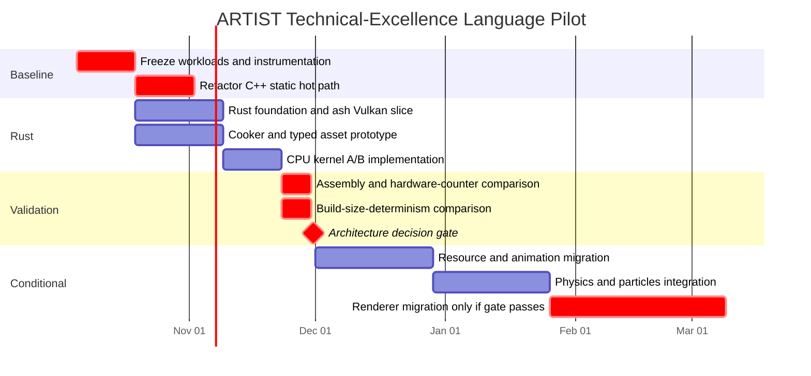

# ARTIST, Rust, and the Pursuit of Technical Excellence

## Executive summary

**My recommendation is not to migrate ARTIST wholesale from C++ to Rust today.** For the objective you have now clarified—**technical excellence measured in generated code, CPU/GPU throughput, cache behavior, branch behavior, determinism, compile-time work, build cost, and predictability rather than feature velocity—modern C++ remains unusually well aligned with the core philosophy of ARTIST.** In particular, C++20/23 has a materially richer stable compile-time language than stable Rust: class and value templates, structural non-type template parameters, concepts, `constexpr`, `consteval`, `if constexpr`, and C++23 `if consteval` let you encode more of a rendering architecture directly into the type/value system than stable Rust const generics currently permit. Rust's current stable const generic parameters remain limited to primitive integral-like types, `char`, and `bool`, with additional restrictions on generic constant expressions. citeturn14view0turn14view1turn14view2turn22search7

That does **not** mean the existing ARTIST architecture is already optimal. In fact, examining the repository makes your earlier concern very concrete: ARTIST performs genuinely useful compile-time selection through `Pipeline<API, PROFILE>`, `Pass<API, PROFILE>`, concepts, `requires`, and `if constexpr`, but then frequently passes through **virtual interfaces, `std::shared_ptr`, heap-backed heterogeneous containers, and string-keyed maps**. For example, `IPipeline<API>` has virtual operations and owns a `shared_ptr<PipelineContext>`; `IPass<API>` has virtual `load/use/free` paths, stores its context behind `shared_ptr`, iterates `vector<shared_ptr<IShader<API>>>`, and accesses uniforms and attributes through string-keyed `unordered_map`s. fileciteturn6file0L1-L13 fileciteturn10file0L1-L10 fileciteturn11file0L1-L13

So I would **keep your philosophy but change where you draw the boundaries**:

> **Templates/static polymorphism should encode algorithms and invariants. Cook-time should encode content. Runtime data should encode changing state. Dynamic polymorphism should exist only at coarse, cold boundaries.**

That is more important than choosing Rust versus C++.

The strongest technical architecture for the engine you describe is therefore not “everything at compile time.” It is a **four-stage architecture**:

| Stage | What belongs there | Objective |
|---|---|---|
| **Compile time** | Backend policy, algorithms, fixed pipeline topology, vertex/resource schemas, SIMD kernel families, compile-time validation | Eliminate repeated runtime decisions and expose optimization opportunities |
| **Cook time** | Shader variants, material keys, reflection, asset layouts, LOD/mesh preprocessing, animation compression, particle definitions | Remove content-dependent work without creating one CPU template instantiation per asset |
| **Load/init time** | Vulkan PSOs, descriptor/resource tables, GPU memory placement, caches, handle tables | Turn cooked descriptions into hardware objects once |
| **Frame time** | Culling results, animation state, transforms, contacts, particles, resource residency, indirect draw counts | Keep only things that genuinely change each frame |

This distinction matters because Vulkan itself acknowledges that pipeline creation can involve expensive work and explicitly provides pipeline caching to reuse results; shader specialization and pipeline variants can therefore be shifted out of the hot frame loop without requiring every material permutation to become a C++ type. citeturn16search13turn16search17

### Bottom-line language decision

For **ARTIST's rendering kernel and compile-time composition layer**, I would currently choose:

**C++23 > Rust**, given *your* objective.

For **asset cooking, parsers, resource-management infrastructure, asynchronous asset I/O, concurrency-heavy engine services, and potentially animation/physics orchestration**, Rust becomes extremely attractive.

For a new Vulkan backend written specifically to test Rust, I would use **`ash`, not `wgpu`**, because `ash` is intentionally close to Vulkan and exposes Vulkan semantics with little policy; its own documentation describes it as a lightweight Vulkan wrapper and makes clear that the low-level API is unsafe rather than pretending the Vulkan model is safe. `wgpu` deliberately supplies a higher-level cross-platform abstraction over Vulkan, Metal, Direct3D 12, and other backends, which is excellent engineering but works against your desire to evaluate the lowest-level cost model. citeturn7view0turn7view1

The most important recommendation is therefore:

**Do not rewrite first. Refactor the current C++ implementation so that ARTIST actually fulfills its static philosophy, benchmark it, then implement one equivalent Rust/`ash` vertical slice and compare generated machine code.**

If Rust cannot beat or essentially tie that corrected C++ baseline, there is no technical-excellence justification for rewriting the renderer. If it ties the C++ baseline while dramatically improving ownership/concurrency invariants and maintainability, *then* a selective or broader migration becomes technically defensible.

My estimated decision cost is only about **three to six person-months** for a serious A/B prototype around the currently visible ARTIST rendering architecture. A migration of a future, complete game engine with renderer, cooker, animation, particle systems, physics integration, resource management and secondary motion is a much larger **roughly 13–24 person-month engineering program**, with substantial uncertainty. Those are engineering estimates based on the observed current repository—which is still principally a graphics abstraction using GLM, GLFW, GLEW and OpenGL rather than an already-complete engine with physics/animation subsystems. fileciteturn7file0L1-L13 fileciteturn8file0L1-L12

## What ARTIST is actually doing today

There is an important distinction between **the ARTIST that exists in the repository** and the larger 3D engine you ultimately want.

The repository describes ARTIST as a C++23 low-level rendering toolkit whose core abstractions are `Pipeline`, `Pass`, `Shader`, `Uniform`, and `Attribute`. Its stated design is explicitly based on templates, metaprogramming, composition, C++20 concepts and `requires`-based compile-time validation. The README says that pipeline configurations are intended to be resolved at compile time. fileciteturn7file0L1-L13

The dependency manifest is considerably narrower than a full game engine: it currently lists GLM, GLFW, GLEW, the system OpenGL package and `magic_enum`. There is no current physics package, animation runtime, production asset importer or Vulkan dependency in that manifest. Therefore, physics, animation, cloth, hair and advanced particles should be treated as **future architectural scope**, not existing ARTIST code that merely needs translation. fileciteturn8file0L1-L12

### The static design is real

The compile-time part of your idea is not imaginary or misguided.

`Pipeline<API, PROFILE>` is constrained by:

```cpp
requires(API::Validator::template validatePipeline<API, PROFILE>())
```

and then uses `if constexpr` to decide whether profile-specific components exist before invoking static component functions. `Pass<API, PROFILE>` follows the same pattern for loading, freeing, using, uniform discovery and attribute discovery. This lets the compiler discard unavailable branches during template instantiation rather than testing them at run time. fileciteturn6file0L1-L13 fileciteturn10file0L1-L10

That is exactly the sort of thing modern C++ is good at. `if constexpr` discards the unselected branch during instantiation under the relevant conditions, while `consteval` gives C++ immediate functions whose invocation must satisfy constant-evaluation requirements. C++ also permits structural types as constant template parameters, which makes it possible to represent considerably richer configuration objects in the template domain than stable Rust const generics currently allow. citeturn14view0turn14view1turn14view2

### But the hot path reintroduces runtime mechanisms

The contradiction appears one layer below.

`IPipeline<API>` itself is polymorphic. It has a virtual destructor; methods such as `getPassesCount()`, `useNext()`, `use()`, `reset()` and `getContext()` participate in a virtual interface, and the specialized `Pipeline<API, PROFILE>` overrides protected virtual `use(context)` and `reset(context)` functions. The compile-time-selected implementation is therefore reached through a runtime polymorphic boundary unless the optimizer can prove enough about the concrete object to devirtualize it. fileciteturn6file0L1-L13

The same happens more aggressively in `Pass`. `IPass<API>` has virtual `load`, `use`, `free` and several pure virtual helper functions; its specialized `Pass<API, PROFILE>` overrides them and only *inside that overridden path* reaches the `if constexpr`-selected static component. fileciteturn10file0L1-L10

The repository-wide virtual search confirms that this pattern is not isolated: shader, pipeline, pass, attribute and several context classes all expose virtual operations or virtual destruction. fileciteturn5file0L1-L16 fileciteturn5file1L17-L32 fileciteturn5file2L33-L48 fileciteturn5file4L65-L80

At the same time, ownership is propagated deep into rendering operations. The implementation uses `shared_ptr` for passes, shaders, contexts, uniforms and attributes; even the static OpenGL component functions receive contexts as `shared_ptr`. fileciteturn9file0L1-L12 fileciteturn9file3L51-L62 fileciteturn9file8L128-L138 fileciteturn9file12L172-L182

And `PassContext` stores:

```text
vector<shared_ptr<IShader<API>>>
unordered_map<string, shared_ptr<Uniform<API>>>
unordered_map<string, shared_ptr<IAttribute<API>>>
```

which means a design that begins with compile-time pipeline composition ultimately traverses runtime containers, ownership wrappers and, for uniforms/attributes, hash tables indexed by strings. fileciteturn11file0L1-L13

That is where I would focus before contemplating a language migration.

### Why this matters more than the raw cost of a virtual call

The technical problem is **not simply “a virtual call costs a few cycles.”**

The larger danger is that a dynamic boundary may prevent a chain of transformations that you actually want: devirtualization, inlining, constant propagation, dead-code elimination, loop restructuring and exposure of surrounding state to the optimizer. Whole-program optimization and LTO can sometimes recover those opportunities, but relying on LTO to discover that a supposedly dynamic architecture is actually static is weaker than expressing the invariant directly. LLVM's LTO exists specifically to allow inter-module optimization, and Rust exposes both Thin and fat LTO for similar whole-program optimization purposes. citeturn13search34turn22search4

Conversely, **inlining everything is not itself technical excellence**. Rust's compiler documentation explicitly notes that the compiler already makes inlining decisions automatically and that bad forced-inlining choices can make programs slower; its `#[inline]`, `#[inline(always)]` and `#[inline(never)]` annotations remain optimization instructions/hints rather than a magical guarantee of superior execution. The same underlying engineering consideration applies to C++: duplicating large specialized functions everywhere can increase `.text` size and instruction-cache pressure. citeturn21view0

So your real target should be:

> **Remove unpredictable runtime decisions from high-frequency paths, while keeping the generated instruction working set small enough to remain cache-efficient.**

That is subtler—and better—than “no function calls.”

### What I would change in ARTIST before changing language

The ideal hot path would look conceptually more like:

```cpp
template<class Backend, class... Passes>
class StaticPipeline {
    std::tuple<Passes...> passes_;

public:
    void record(FrameContext& frame) noexcept {
        std::apply(
            [&](auto&... pass) {
                (pass.record(frame), ...);
            },
            passes_);
    }
};
```

Here the pipeline's **algorithmic topology** is a type. The context is borrowed rather than shared-owned. There is no requirement for a vtable between `record()` and a concrete pass.

That does not mean every material becomes a template parameter. It means the *kind of operation* is static while the data flowing through the operation can remain runtime data.

For ARTIST specifically, I would:

| Existing mechanism | Technical-excellence target | Why |
|---|---|---|
| `IPipeline` / `IPass` virtual hot calls | Concrete/generic pipeline execution | Makes static dispatch explicit instead of hoping for devirtualization |
| `shared_ptr<Context>` passed through hot calls | `Context&`, pointer, span/view, or arena handle | Ownership should be resolved outside the invocation path |
| `vector<shared_ptr<IShader>>` | Contiguous records / stable handles / batches | Better locality and simpler lifetime model |
| `unordered_map<string, Uniform>` during rendering | Cooked integer IDs, offsets or generated layouts | Removes hashing/string work from the frame path |
| Dynamic heterogeneous pass graph | Static coarse pass topology + dynamic instance data | Keeps compiler-visible structure without specializing per object |
| Compile-time profiles for every possible content variant | Templates for algorithm families; cooked IDs for content | Prevents monomorphization explosion |

The existing code clearly contains the first four source patterns; the replacements are my architectural recommendation rather than a statement about current ARTIST. fileciteturn6file0L1-L13 fileciteturn10file0L1-L10 fileciteturn11file0L1-L13

**This refactoring is worth doing even if you eventually choose Rust.** A naive Rust translation that replaces `shared_ptr<T>` with `Arc<T>` and `virtual` with `dyn Trait` would preserve much of the same architectural dynamism. Rust only gives you the full performance/safety benefit if you redesign ownership and dispatch boundaries rather than transliterating them.

## Rust versus modern C++ for technical excellence

The central mistake would be to reduce the comparison to “Rust is safe, C++ is fast.” Both languages can be compiled to aggressively optimized native code; for ARTIST the decisive differences are instead **what each language lets you express statically, what invariants it can prove, and how much engineering machinery is required to reach the machine code you want**. Rust's release compiler exposes LLVM optimization, LTO, PGO, codegen-unit control and target-feature mechanisms; C++ toolchains such as Clang can use the same LLVM optimization infrastructure. citeturn22search4turn13search34

### Direct comparison

| Attribute | Modern C++20/23 | Current stable Rust | ARTIST verdict |
|---|---|---|---|
| **Compile-time language** | Templates, specialization, concepts, `constexpr`, `consteval`, `if constexpr`, `if consteval`, rich NTTPs including structural literal types. citeturn14view0turn14view1turn14view2 | `const fn`, const evaluation, traits, const generics, declarative/procedural macros. Stable const generic parameter types remain restricted to primitive scalar-like types. citeturn22search7turn15view1turn15view2turn15view3 | **C++ clear advantage** for your static-pipeline philosophy |
| **Static polymorphism** | Templates/concepts are extremely expressive; familiar basis of ARTIST already. fileciteturn7file0L1-L13 | Generic functions and traits monomorphize concrete generic instantiations. citeturn3search6 | **Tie for ordinary generic dispatch**; C++ wins exotic type/value metaprogramming |
| **Zero-cost abstraction potential** | Excellent; template abstraction can disappear in optimized output | Excellent; monomorphization and LLVM optimization permit abstraction to disappear | **Effectively tie; benchmark generated code** |
| **Inlining / LTO / PGO** | Mature compiler LTO/PGO; LLVM supports cross-module optimization. citeturn13search34 | Thin/fat LTO, PGO, codegen-unit tuning explicitly exposed by `rustc`. citeturn22search4 | **Tie in capability** |
| **Build-time control** | Templates/header instantiation can become expensive; current ARTIST already uses template-heavy headers | Generics, proc macros, LLVM optimization and low `codegen-units` can also be expensive; rustc documents compile-time/performance trade-offs. citeturn22search4 | **No universal winner** |
| **Code-size risk** | Specialization/template instantiation can duplicate machine code | Monomorphized generics can similarly produce per-instantiation machine code. citeturn3search6 | **Tie in mechanism; architecture decides** |
| **Memory/lifetime safety** | Manual discipline/tooling | Ownership/borrowing and safe abstractions give much stronger compile-time guarantees; unsafe can be isolated | **Rust decisive advantage** |
| **Concurrency correctness** | Powerful, but synchronization/lifetime correctness largely programmer responsibility | `Send`/`Sync` encode thread transfer/sharing constraints in the type system. citeturn12view2 | **Rust advantage**, runtime speed not automatically higher |
| **SIMD** | Mature compiler vectorization/intrinsics and long-standing C++ math ecosystem | Architecture intrinsics through `core::arch` are available; portable `std::simd` remains experimental/nightly in current documentation. citeturn12view0turn12view1 | **C++ advantage for stable portable low-level SIMD today** |
| **Raw Vulkan** | Excellent native ecosystem and direct Vulkan API access | `ash` exposes a lightweight, close-to-Vulkan binding with explicit unsafe operations. citeturn7view1 | **Performance/control tie in principle** |
| **Portable GPU abstraction** | Many options, but no language-standard layer | `wgpu` provides Vulkan/Metal/D3D12 and other backend support around WebGPU semantics. citeturn7view0 | Rust ecosystem attractive, but **not your primary objective** |
| **Physics ecosystem** | Bullet and NVIDIA PhysX provide established C++ options; PhysX includes broad simulation capabilities. citeturn9view1turn17search19 | Rapier provides Rust-native 2D/3D physics, SIMD/parallel options and determinism facilities; its docs still identify it as pre-1.0. citeturn18view0turn18view1 | **C++ ecosystem broader; Rust viable if Rapier fits** |
| **Native SDK interop** | Natural fit for C/C++ SDKs | C-compatible boundary required for robust mixed-language architecture; Vulkan itself is straightforward | **C++ advantage** for mixed native ecosystem |
| **Metaprogramming ergonomics for ARTIST** | Complex, but extremely expressive and already embodied by project design | Traits are cleaner for many constraints, but advanced const/type-level configuration often requires macros or code generation | **C++ advantage for this particular design** |
| **Unsafe low-level work** | Effectively unrestricted throughout language | Can be confined to `unsafe` modules/blocks; `ash` intentionally exposes unsafe Vulkan operations. citeturn7view1 | **Rust advantage for architectural containment** |
| **Runtime determinism** | Language does not guarantee deterministic engine behavior | Rust safety removes classes of races/UB but does not make floating-point/GPU simulation magically deterministic; Rapier offers specific determinism modes. citeturn18view1 | **Architecture/library-dependent** |

### Compile-time metaprogramming is the largest argument for staying in C++

This is the part most directly connected to your philosophy.

Stable Rust has const generics, but according to the current Rust Reference the permitted const-parameter types are integer types, `usize`/`isize`, `char`, and `bool`. It also still restricts certain type-level generic expressions; for example, generic const values in array-type/repeat contexts face standalone-expression constraints. citeturn22search7

C++ constant template parameters are much richer. The C++ standard model permits structural types, including scalar values, references and qualifying literal class types, as constant template parameters. Combined with concepts, specialization and immediate/constant functions, this gives C++ a larger language for constructing a compile-time rendering DSL. citeturn14view0turn14view1

Rust procedural macros are powerful, but they solve a different problem. They run during compilation and transform token streams into token streams; they are effectively compile-time code generators. That can build a beautiful engine DSL, but it introduces a separate macro crate/code-generation layer and is not the same as making arbitrary rich values participate natively in generic type evaluation. citeturn15view2turn15view3

So if the thing you most enjoy and value about ARTIST is:

> “The renderer's legal structure is a compile-time program and invalid combinations should fail during compilation,”

then **moving to Rust would currently make some of the most ambitious forms of that design harder, not easier**.

### Rust's strongest advantage is ownership architecture, not raw speed

Rust's compelling argument is elsewhere.

ARTIST currently expresses widespread shared ownership in the renderer. Rust would force you to decide more explicitly whether something is owned, mutably borrowed, immutably borrowed, reference counted, or represented through an external/raw resource. That can lead to much cleaner resource lifetime graphs and can prevent concurrency mistakes through `Send`/`Sync` constraints. citeturn12view2

But the performance gain is **not automatic**.

A Rust engine based on:

```rust
Arc<Mutex<dyn Pass>>
```

everywhere would not suddenly become an ideal static renderer merely because it is Rust.

A better Rust design would look much more like:

```rust
fn record<P: Pass>(
    pass: &mut P,
    frame: &mut FrameContext,
) {
    pass.record(frame);
}
```

with concrete generic types for hot kernels, slices/arenas/handles for collections, and `dyn Trait` reserved for cold extension boundaries.

In other words, **Rust strongly encourages a resource-lifetime architecture that you can also implement in C++, but Rust can enforce much more of it.** That is a technical-excellence advantage, especially as the engine becomes multithreaded; it is simply not a reason to expect higher FPS by itself. citeturn12view2

### SIMD is one place where C++ is still more comfortable for this project

Rust provides stable architecture-specific SIMD intrinsics through `core::arch`, including explicit target-feature control and runtime feature detection. That is enough to write serious AVX2/AVX-512/SSE kernels. citeturn12view1

However, the standard portable SIMD API documented as `std::simd` is still marked experimental/nightly in the current Rust documentation. It can map portable operations to available SIMD, but it is not yet the completely stable high-level answer you might expect from a production engine toolchain. citeturn12view0

For animation blending, skinning, particle update, culling and constraint solving, that pushes me slightly toward C++ today if your goal is to aggressively experiment with predictable vector code while staying entirely on stable production language features.

It is not a blocker for Rust—explicit x86 intrinsics are available—but it reduces Rust's ergonomic advantage in one of the engine areas you care most about.

### Async is mostly irrelevant to the hot frame

Rust's async model can be useful for asset streaming, file/network I/O and tool-side workflows, but I would not build the simulation/render execution graph around async futures merely because Rust makes them convenient. For deterministic frame work, an explicit task/job scheduler over fixed frame dependencies is generally the more relevant model.

That means async should have almost no weight in the C++ versus Rust renderer decision. It becomes useful at the engine periphery, where Rust is already a stronger candidate.

### GPU performance will not come from the language

With raw Vulkan, the CPU language is responsible for preparing Vulkan objects and command streams; the GPU ultimately executes shaders and Vulkan work rather than “Rust code” or “C++ code.” `ash` deliberately exposes Vulkan almost directly, while `wgpu` adds a portable API layer supporting Vulkan, Metal and Direct3D 12 among its native backends. citeturn7view0turn7view1

Therefore, for your assumed x86-64/Vulkan target:

**C++ + Vulkan and Rust + `ash` should be treated as two implementations of essentially the same backend architecture.**

The deciding benchmark is consequently **CPU-side submission cost, allocations, synchronization, pipeline lookup, barrier generation and generated assembly**, not GPU shader throughput. A Rust implementation that sends the same shader, same resources and same Vulkan command sequence should not be expected to make the GPU intrinsically faster.

## What should be static, cooked, dynamic, and data-driven

This is the most important architectural answer in the report.

The question should not be:

> “Can this be compile-time?”

Almost everything sufficiently constrained *can* eventually be encoded in types or generated source.

The better question is:

> **“Does moving this decision earlier eliminate meaningful recurring cost without creating a larger build/code/cache cost somewhere else?”**

The key rule is:

**Static when the choice space is small and closed. Cooked when it scales with content. Dynamic when reality changes at runtime. Data-driven does not imply dynamically polymorphic.**

### The preferred boundary

| Engine concept | Preferred stage | Why | Runtime cost | Build/code cost |
|---|---|---|---|---|
| Graphics backend for a Vulkan-only binary | **Static** | Known for entire executable | Minimal | Separate binary/instantiation per backend |
| Render algorithm family | **Static** | Small closed set; called frequently | Minimal dispatch | More generic/template code |
| Fixed pass topology | **Static or generated** | Enables dead-code elimination and validation | Very low | Higher rebuild cost |
| Vertex schema/layout family | **Static + generated reflection** | Hardware-facing invariant | Very low | Moderate code generation |
| Descriptor/resource-layout contract | **Static + cook-time reflection** | Invariant but shader-derived | Very low | Requires tooling |
| SIMD kernel variant | **Static compiled variants + runtime CPU-feature choice once** | Small finite set | One coarse dispatch | Multiple machine-code copies |
| Shader source -> SPIR-V | **Cook time** | Content-dependent but immutable during play | None during frame | Cooker/tool complexity |
| Material -> shader/pipeline key | **Cook time** | Potentially thousands of materials | Integer/table lookup | Asset rebuild on schema changes |
| Shader permutations | **Cook time** | Large content-driven combination space | PSO/key lookup | Cook/storage growth |
| Mesh LOD / meshlet generation | **Cook time** | Expensive, content-specific | Minimal frame work | Longer asset pipeline |
| Skeleton remapping | **Cook time** | Asset invariant | Smaller animation work | Cooker complexity |
| Animation curve compression | **Cook time** | Asset invariant | Less bandwidth/compute | Offline processing |
| Particle emitter definitions | **Cook time/data-driven** | Designers/content create many instances | Compact runtime interpretation | Schema/versioning |
| Vulkan PSO creation | **Load/init + cache** | Hardware/driver operation, not per-frame decision | Avoided in frame | Startup/cache management |
| Object visibility | **Dynamic** | Camera changes every frame | Must compute | None |
| Draw count/indirect args | **Dynamic** | Visibility/LOD changes | Must compute | None |
| Transform matrices | **Dynamic** | Gameplay/animation changes | Must compute | None |
| Animation blend weights/state | **Dynamic** | Gameplay changes | Must compute | None |
| Physics contacts | **Dynamic** | Emergent simulation result | Must compute | None |
| Hair/cloth positions | **Dynamic state with static kernel** | State changes, solver algorithm need not | Compute required | Specialized solver code |
| Particle population | **Dynamic state with static GPU kernel** | Birth/death/state changes | Compute required | Shader/kernel variants |
| Asset file descriptions | **Data-driven, cooked** | Content should not require C++ recompilation | Compact load cost | Cooker/schema complexity |

Vulkan's own facilities strongly support this split: pipeline creation can involve expensive implementation work and pipeline caches exist to preserve/reuse that work, while specialization constants and pipeline configurations provide controlled specialization without requiring the CPU program to turn every content permutation into a C++ template type. citeturn16search13turn16search17

### The critical distinction: data-driven is not dynamic dispatch

Suppose your game has 2,000 materials.

You could define:

```cpp
Material<Cloud, AlphaBlend, DoubleSided, ...>
Material<SquallJacket, Opaque, DoubleSided, ...>
Material<BalambWall17, Opaque, SingleSided, ...>
```

and generate concrete CPU code for every configuration.

That maximizes “compile-time-ness,” but it is not automatically excellent engineering.

Most of those materials probably share a much smaller number of **algorithmic families**.

A stronger design is:

```text
2,000 source materials
        ↓ cook
120 validated material configurations
        ↓ permutation reduction
18 shader/pipeline families
        ↓ compile
18 static execution kernels / PSO families
        ↓ runtime
compact MaterialId / PipelineKey per instance
```

Here the engine is still aggressively static. The hot kernel can remain monomorphic for an entire batch. But content does not cause unbounded CPU template instantiation.

That helps control a cost both C++ and Rust share: concrete generic/template instantiations can produce separate machine-code bodies. Rust explicitly uses monomorphization for generics, and C++ similarly instantiates template specializations. citeturn3search6turn14view3

### Batch the dynamic decision

This is the pattern I would make foundational:

```text
bad:
object
  -> polymorphic material call
  -> polymorphic pass call
  -> polymorphic shader call
  -> draw

better:
objects
  -> cull
  -> compute PipelineKey
  -> sort/group
  -> select static kernel once per batch
  -> process N objects
```

The second architecture does not pretend the game world is compile-time static. Instead, it moves dynamic choice out of the inner loop.

That is much closer to “technical excellence” than eliminating every branch indiscriminately.

### Where virtual dispatch is perfectly acceptable

I would **not** ban virtual dispatch or Rust trait objects globally.

They are appropriate for cold/coarse boundaries such as:

- asset importer plug-ins;
- editor/tool extensions;
- selecting a graphics backend once during initialization;
- optional telemetry/profiling systems;
- platform services;
- game scripting boundaries.

The key is that none of those should execute once per draw, vertex, bone, particle or constraint.

ARTIST's current problem is not “it contains virtual functions.” It is that virtual/shared ownership boundaries appear directly in concepts named `Pipeline`, `Pass`, `Shader` and their contexts—precisely where your compile-time design is supposed to provide the most benefit. fileciteturn5file0L1-L16 fileciteturn5file1L17-L32 fileciteturn5file2L33-L48

### Cost model for each architectural choice

The following is an engineering assessment rather than a benchmark result; the exact magnitude must be measured on ARTIST.

| Choice | Runtime | Build time | Binary/code size | Development | Maintainability | Flexibility |
|---|---:|---:|---:|---:|---:|---:|
| **Aggressive static/template specialization** | **Very low** | High–very high | Medium–very high | High | Medium | Low |
| **Static algorithm + cooked content** | **Very low** | Medium | Low–medium | High initially | **High once mature** | High |
| **Generated source/code from asset schemas** | **Very low** | Medium | Medium | High tooling cost | High if generator is disciplined | High |
| **Runtime tagged enum / switch, batched** | Low | Low | Low | Low–medium | High | High |
| **Virtual dispatch once per coarse subsystem** | Negligible in practice at that frequency | Low | Low | Low | High | Very high |
| **Virtual dispatch in tight inner loops** | Potentially significant through indirect branches and lost optimization opportunities | Low | Low | Low | Medium | Very high |
| **String/hash lookup in hot paths** | Avoidable recurring work and locality cost | Low | Low | Low | Easy initially | High |
| **Cooked integer IDs/offsets** | **Very low** | Cooker work | Low | Medium | High | High |
| **Shared ownership everywhere** | Extra lifetime machinery and weaker ownership/locality clarity | Low | Low | Easy initially | Often deteriorates at scale | High |
| **Arena/handle + borrowed access** | **Very low and predictable** | Low | Low | Medium | High if ownership model is clear | High |

The reason “static algorithm + cooked content” scores best overall is that it preserves the optimizer's view of high-frequency algorithms without forcing your executable to contain a unique machine-code copy for every piece of game content. The same monomorphization/codegen trade-off exists in both languages, while Rust's own compiler documentation explicitly exposes compile-time versus generated-performance trade-offs through settings such as `codegen-units` and LTO. citeturn3search6turn22search4

## Migration architecture and build-versus-buy decisions

A rewrite should be treated as an experiment until it passes a measurable gate.

### Which ARTIST modules I would touch first

Because today's ARTIST repository is predominantly the renderer abstraction rather than a finished engine, I would separate **refactoring order** from **future engine migration order**. The current source tree visibly concentrates around graphics API/context/pipeline abstractions and OpenGL components. fileciteturn3file0L1-L2

| Priority | Module / experiment | Language strategy | Reason |
|---|---|---|---|
| **Baseline** | `Pipeline` / `Pass` / contexts | **Refactor in C++ first** | Establish what the original philosophy can achieve when virtual/shared hot-path boundaries are removed |
| **Pilot** | Vulkan backend | Implement second version in **Rust + `ash`** | Best apples-to-apples low-level comparison; `ash` exposes Vulkan closely. citeturn7view1 |
| **Early Rust candidate** | Asset cooker / shader reflection / serialization | **Rust** | Excellent place for ownership/parser safety; compile/cook-time philosophy benefits without frame-time FFI |
| **Benchmark candidate** | Culling / animation blend / skinning | **Both C++ and Rust** | CPU/cache/SIMD-heavy and self-contained; exposes actual codegen quality |
| **Later** | Resource registry / lifetime system | Rust candidate | Rust ownership model can provide architectural value here |
| **Later** | Particle simulation | GPU-first, CPU orchestration in chosen language | Performance dominated by data layout/kernel architecture rather than host language |
| **Later** | Physics | Buy, do not rewrite solver | Extremely large specialist domain |
| **Last** | Whole renderer migration | Conditional | Only after the pilot demonstrates a technical advantage or at least parity plus substantial safety gain |

There is one apparent paradox here: **the renderer is simultaneously the first thing to benchmark and the last thing I would commit to migrating**.

That is intentional.

It is the first benchmark because it is ARTIST's core idea.

It is the last irreversible migration because C++ is currently strongest exactly where ARTIST is most metaprogramming-heavy.

### Rendering: build the architecture, buy the Vulkan binding

For a Rust proof:

**Use `ash`.**

Its documented goal is a lightweight Vulkan wrapper with API-level fidelity, generated from Vulkan definitions, with low-level calls remaining unsafe. That makes it suitable for testing whether Rust can preserve your desired predictability rather than testing a higher-level rendering abstraction. citeturn7view1

I would structure it as:

```text
safe renderer domain
    |
    +-- typed PipelineKey / MaterialId
    +-- typed handles
    +-- render graph / batch scheduler
    +-- resource lifetime state
    |
unsafe Vulkan island
    |
    +-- ash instance/device
    +-- raw resource creation/destruction
    +-- command encoding
    +-- barriers/synchronization
```

That architecture gives you one of Rust's genuine advantages: unsafe GPU interaction can be quarantined rather than allowed to contaminate the entire engine.

`wgpu` would be reasonable later if portability to Metal/D3D12 becomes more important than direct API control; its documented backends include Vulkan, Metal and Direct3D 12. But under your present assumptions, choosing it for the primary experiment would confound the language comparison with an API-abstraction comparison. citeturn7view0

### Physics: buy it

I would **not write a general rigid-body physics engine** as part of this project unless physics engineering itself is one of the experiences you specifically want.

For a Rust-native engine, Rapier is a credible candidate. Its current documentation exposes 2D/3D physics, parallel execution, SIMD modes and determinism-related features. Its documentation also explicitly warns that the project remains pre-1.0 and can make breaking changes. citeturn18view0

Rapier's determinism model is particularly relevant to your objective: its documentation distinguishes same-machine determinism from enhanced cross-platform determinism and documents the conditions required. citeturn18view1

For broader simulation scope, PhysX remains attractive on the C++ side; NVIDIA's current material includes rigid bodies as well as technologies such as FEM soft bodies, cloth, particles and fluids. citeturn17search19

Therefore my build-versus-buy split would be:

| Need | Recommendation |
|---|---|
| Rigid bodies, collision, joints | **Buy**: Rapier or PhysX |
| Broad cloth/soft-body ecosystem | Prefer **PhysX initially** if its model meets the game |
| Hair strands / ponytails / accessories | Build a small game-specific secondary-motion layer once requirements are clear |
| Full realistic hair simulation | Do not build unless it is a research goal |
| Character cloth such as coats/skirts | Use constrained lightweight simulation or physics-library facilities; game-specific quality matters more than physical completeness |
| Collision acceleration structures | Use chosen physics/runtime infrastructure rather than independently reinventing everything |
| Game-facing physics API | **Build**, so library choice stays replaceable |

If the engine stays C++ but you want to experiment with Rust subsystems, a coarse FFI boundary around a complete physics step can be reasonable. The boundary should look like “submit body arrays / simulate / receive transforms,” not thousands of individual cross-language calls.

### Math

Current ARTIST uses GLM. fileciteturn8file0L1-L12

C++ additionally has long-established template math libraries such as Eigen. citeturn9view0

Rust has mature linear algebra libraries such as `nalgebra`. citeturn8view1

I would **not choose the language based on the math library**. For technical excellence, the decisive question is whether the exact transforms, blends, matrix operations and SIMD kernels you use compile into the desired instruction sequence. That should be answered through assembly and hardware counters.

### Animation

Animation is a good candidate for custom engine code because your desired behavior is game-specific and performance-critical.

I would make:

```text
SkeletonDefinition       cooked / immutable
AnimationClip            cooked / compressed
BoneRemap                cooked
Pose buffers             runtime contiguous arrays
Blend graph structure    mostly cooked
Blend weights            runtime
Hierarchy evaluation     static kernel
Skinning                 static SIMD/GPU kernel
```

The important point is that a Squall animation clip should **not** instantiate a unique C++ template or Rust generic function. It should feed a generic, statically optimized animation kernel through compact cooked data.

### Particles

The same principle becomes even stronger for particles:

```text
Emitter schema       data-driven
Emitter compilation  cook-time
Kernel family        static shader
Emitter parameters   runtime buffer
Particle state       GPU data
Simulation           GPU compute
Rendering            GPU indirect/batched
```

The CPU should ideally submit batches and update compact parameters rather than dynamically dispatch behavior per particle.

This is a perfect example of why “maximum compile-time” is not equivalent to “maximum technical excellence.” A million particles do not need a million statically specialized C++ objects; they need a tiny number of highly efficient static kernels operating on well-laid-out dynamic data.

### Hair and cloth

For the quality level you described—visible motion without research-grade realism—I would begin with a modest constraint-based secondary-motion subsystem rather than making the general physics engine responsible for every strand.

The algorithm itself can be static:

```text
integrate
→ apply constraints
→ collision
→ solve N iterations
→ reconstruct render transforms
```

while the state remains dynamic:

```text
positions
previous positions / velocities
constraint lengths
collision proxies
wind parameters
```

That pattern is equally viable in C++ and Rust. It is an excellent later benchmark for data-oriented SIMD and multithreading.

## Benchmarks and measurable success criteria

I would explicitly reject generic “C++ versus Rust benchmark shootouts” as the decision mechanism here.

They answer the wrong question.

Your relevant question is:

> **What machine code do C++ ARTIST and Rust ARTIST generate for the exact architecture I want?**

Both ecosystems expose sufficiently strong optimization controls that a language shootout on unrelated algorithms says far less than an A/B implementation of your renderer, animation and culling paths. Rust, for example, exposes Thin/fat LTO, codegen-unit tuning and PGO; those settings themselves trade compilation cost against generated-code quality. citeturn22search4

### Establish a benchmark corpus before the rewrite

Create immutable workloads and run both implementations against them.

| Area | Benchmark | Primary metrics |
|---|---|---|
| Pipeline dispatch | 1M pipeline/pass invocations: static, virtual/dyn, mixed-profile | cycles/op, instructions/op, branch misses, I-cache misses |
| Material resolution | current string-map path vs cooked ID path | ns/lookup, L1/LLC misses, allocations |
| Render submission | 1k / 10k / 100k visible instances | CPU submission ms, calls, branches, allocations |
| Culling | 1M AABBs against realistic frusta/occlusion inputs | cycles/object, vectorization, cache misses |
| Animation blend | representative 50–150-bone skeletons | ns/bone, cycles, branch misses |
| Hierarchy evaluation | representative character counts | CPU ms, cache misses, p95/p99 |
| Skinning | 100k–1M vertices | vertices/s, SIMD width, memory bandwidth |
| Particles | 100k and 1M particles | update throughput, GPU/CPU time |
| Hair/cloth | 32/64/128-node chains across many actors | constraints/s, p99 simulation time |
| Job scheduler | tiny/medium/large tasks | enqueue latency, steal rate, throughput |
| Resource handle lookup | millions of resolves | cycles/lookup, cache misses |
| Vulkan recording | equivalent command streams | ns/draw/dispatch, CPU submission ms |
| Pipeline creation | cold/warm cached startup | PSO creation latency, cache hit behavior |
| Deterministic replay | fixed 10k-frame simulation | state hashes, divergence frame |
| Builds | clean + representative incremental edits | wall time, CPU time, peak RAM |
| Link optimization | release Thin/fat LTO | link time, binary `.text`, benchmark delta |

Vulkan pipeline caching should be benchmarked independently because pipeline construction itself can contain expensive driver/compiler work and the API explicitly provides caches to reuse it. citeturn16search13

### Collect hardware counters, not only wall-clock time

For each CPU benchmark I would collect:

```text
cycles
instructions
IPC
branches
branch-misses
L1 data-load misses
L1 instruction misses
LLC misses
context switches
allocations
bytes allocated
```

The point is to distinguish:

```text
"Rust is 3% slower"
```

from:

```text
"Rust produces identical instructions but this benchmark has noise"
```

or:

```text
"C++ generated 30% more instructions due to abstraction X"
```

or:

```text
"the hyper-specialized C++ implementation has fewer branches
but 4× I-cache misses because its text footprint exploded."
```

The last result would be especially valuable because it directly tests your hypothesis about maximum static flattening.

### Inspect the generated code

For every critical kernel, keep a machine-code artifact in CI:

```text
C++ source
  → optimized LLVM IR where available
  → assembly
  → symbol size

Rust source
  → optimized LLVM IR
  → assembly
  → symbol size
```

Do not ask merely whether the source “looks zero cost.”

Check whether:

- the virtual/trait-object call disappeared;
- the target function was actually inlined where useful;
- bounds checks disappeared from the inner loop;
- vector instructions appeared;
- loop unrolling is sensible;
- redundant loads/stores disappeared;
- constant pipeline state propagated;
- code size stayed reasonable.

Rust's compiler gives direct code-generation controls for optimization level, LTO, codegen units, target features and PGO, while its SIMD facilities expose target-specific intrinsics when you need exact low-level control. citeturn22search4turn12view1

### Suggested migration gates

These are **proposed engineering thresholds**, not universal industry standards. They should be frozen before the A/B test so the language decision cannot be rationalized afterward.

| Metric | Suggested Rust acceptance gate versus best corrected C++ |
|---|---:|
| Hot CPU kernel median cycles | **≤ +2%** |
| Hot CPU kernel p99 | **≤ +3%** |
| Branch-miss rate | **≤ +5% relative** unless compensated by lower total cycles |
| L1D miss rate | **≤ +5% relative** |
| Renderer CPU submission | **≤ +3%** |
| GPU frame time with equivalent work | Within normal benchmark noise |
| Release `.text` size | **≤ +10%** unless measured performance materially improves |
| Clean optimized build | **≤ +25%** |
| Common incremental build | Should not materially worsen the edit–measure loop |
| Hot-loop heap allocations | **0** after initialization |
| Hot-loop reference-count ownership operations | **0** by architecture |
| Static hot-zone indirect calls | **0** unless explicitly justified by benchmark |
| Same-machine deterministic replay | **100% identical state hash** for designated deterministic subsystems |
| Unsafe Rust | Confined to explicit Vulkan/FFI/SIMD implementation boundaries |
| Engine-level race/lifetime defects | Rust should materially reduce the class of defects possible in safe engine code |

The interesting case is **Rust at 0–2% performance difference but much stronger invariants**.

I would consider that a Rust victory for resource management, job orchestration and engine systems.

I would **not automatically consider it enough to justify rewriting the static renderer DSL**, because C++ still gives you substantially more compile-time expressiveness for that particular subsystem. citeturn14view0turn22search7

### Determinism deserves a separate score

Do not conflate memory safety and determinism.

For physics specifically, Rapier documents deterministic behavior under defined conditions and offers an enhanced determinism mode for cross-platform scenarios, while noting relevant constraints. citeturn18view0turn18view1

For the engine overall, record:

```text
Input frame N
RNG seeds
Animation state
Physics state
Particle emitter state
Resource version IDs
        ↓
simulate N frames
        ↓
canonical state hash each frame
```

Then detect the first divergent frame.

For GPU systems, bit-identical results may not always be the right requirement. Define determinism subsystem by subsystem rather than promising universal bit identity.

## Timeline, effort, and final recommendation

There are really **two projects** hiding in the question:

**Project A:** determine whether Rust is technically superior for ARTIST.

**Project B:** migrate the engine to Rust.

You should spend relatively little on Project A before allowing Project B to exist.

### Decision pilot

A rigorous twelve-week pilot is enough to answer most of the language question.



With one senior engineer, that pilot is roughly **three person-months**. With two senior engineers doing the C++ correction and Rust vertical slice in parallel, I would budget roughly **four to six aggregate person-months**, because parallel work adds review/integration overhead rather than dividing perfectly in half. Those are planning estimates based on the modest size and rendering-focused scope visible in the current ARTIST repository, not externally measured migration statistics. fileciteturn1file0L1-L13 fileciteturn3file0L1-L2

### Full-engine engineering estimate

For the **future engine you described**, assuming:

- desktop x86-64;
- Vulkan primary backend;
- 1–3 senior engineers;
- strong agentic code-generation/review/test harness;
- no requirement to invent a physics solver;
- asset importers and selected infrastructure are reused rather than reimplemented;
- emphasis on performance validation rather than a giant editor ecosystem;

I would budget approximately:

| Workstream | Person-months |
|---|---:|
| Instrumentation, deterministic workloads, current C++ baseline | 1–1.5 |
| Correct/static C++ renderer reference architecture | 1–2 |
| Rust engine foundation, FFI and low-level conventions | 1–1.5 |
| Rust/`ash` Vulkan renderer proof | 1.5–2.5 |
| Asset cooker, runtime asset format, shader pipeline | 1.5–2.5 |
| Animation / pose / skinning systems | 2–3 |
| Culling / scene submission / resource handles | 1.5–2.5 |
| Particle system | 1–2 |
| Hair / lightweight cloth secondary motion | 1–2 |
| Physics-library integration | 1–2 |
| Optimization, profiling, deterministic regression suite | 2–3 |
| Migration hardening / FFI removal / cleanup | 1–2.5 |

There is overlap between these workstreams, so I would use **approximately 13–24 person-months** as the practical total range rather than summing every upper bound mechanically.

Approximate calendar ranges:

| Team | Likely calendar range for a technically serious engine core |
|---|---:|
| **1 senior engineer** | ~12–20 months |
| **2 senior engineers** | ~7–12 months |
| **3 senior engineers** | ~5–9 months |

An agentic harness can substantially reduce boilerplate, test generation, bindings, repetitive porting and benchmark scaffolding, but it does not eliminate the serial work that determines the quality of this project: profiling, data-layout experiments, generated-code inspection, GPU debugging, deterministic reproduction and architecture decisions. That is why I would not apply a simplistic “AI makes development 5× faster” multiplier to this kind of work.

### What I would buy and what I would build

| Area | Decision |
|---|---|
| Rendering architecture | **Build** |
| Vulkan binding | **Buy/use existing** — `ash` in Rust |
| Vulkan synchronization/resource policy | **Build** |
| Render graph | Build if it is central to your research objective |
| Shader compiler | **Reuse existing compiler infrastructure** |
| Shader reflection -> engine schema | **Build thin generator/cooker layer** |
| glTF/other asset parsers | **Reuse libraries** |
| Runtime asset format | **Build** |
| Math fundamentals | **Reuse library + custom hot kernels where justified** |
| Animation runtime | **Build** |
| Skinning kernels | Build/optimize |
| Particle engine | **Build game-specific** |
| Rigid-body physics | **Buy/use Rapier, PhysX or equivalent** |
| General cloth/fluid solver | **Buy** unless it is a research objective |
| Lightweight hair/accessory motion | **Build small specialized solver** |
| Job scheduler | Build only if benchmarking shows existing options conflict with your requirements |
| Profiling infrastructure | Reuse platform profilers; build benchmark harness |
| Serialization/editor schemas | Prefer generated/cooked representations |

Rapier's feature set makes it viable for a Rust-native physics strategy, while PhysX's broader simulation facilities make preserving a C++ physics island a perfectly rational hybrid decision. citeturn18view0turn17search19

### The migration decision I would make today

I would **keep ARTIST in C++23 for now**.

More specifically:

**Keep and strengthen:**

```text
C++ concepts
templates
consteval / constexpr
if constexpr
compile-time backend/policy validation
compile-time algorithm composition
static pipeline execution
```

C++'s current standard model is exceptionally capable in exactly those areas. citeturn14view0turn14view1turn14view2

**Remove from hot paths:**

```text
virtual Pipeline/Pass/Shader calls
shared ownership passed through draw operations
string-keyed uniform lookup
heap-oriented heterogeneous object graphs
per-object dynamic dispatch
```

Those mechanisms are visible in the current ARTIST implementation and work against the compile-time structure surrounding them. fileciteturn6file0L1-L13 fileciteturn10file0L1-L10 fileciteturn11file0L1-L13

**Move aggressively to cook time:**

```text
shader compilation
reflection
material permutation reduction
pipeline keys
mesh preprocessing
LOD generation
animation compression
skeleton remapping
asset validation
particle emitter compilation
```

This gives you most of the “nothing unnecessary happens at runtime” property you are after without turning content count into machine-code count.

**Use runtime data only for things that genuinely are runtime:**

```text
visibility
transforms
blend weights
physics state
contacts
particle state
hair/cloth state
streaming/residency
indirect command counts
```

And **dispatch those dynamic states into static kernels in large batches**.

### The deeper conclusion

I would not abandon your metaprogramming philosophy.

I would refine it.

Your original intuition was:

```text
more compile-time
      ↓
fewer runtime decisions
      ↓
more inlining
      ↓
faster engine
```

The stronger version is:

```text
                         ┌─ small + closed + algorithmic ──→ compile time
decision / information ─┼─ content-dependent + immutable ─→ cook time
                         ├─ hardware-object creation ───────→ load time
                         └─ genuinely changes every frame ─→ runtime
```

Then, inside the runtime branch:

```text
dynamic world state
      ↓
compact keys / handles
      ↓
batch and sort
      ↓
one coarse dispatch
      ↓
static specialized kernel
      ↓
contiguous data
```

That is, in my view, **closer to technical excellence than an engine in which everything is a template**.

The purpose of metaprogramming should not be to prove that the compiler can compute everything.

It should be to make **the things that are invariant impossible to pay for repeatedly**.

And the purpose of data-driven design should not be to surrender static guarantees.

It should be to prevent **content diversity from becoming code diversity**.

That distinction is why I would not currently rewrite ARTIST's core in Rust. Rust is technically excellent and would likely improve large parts of the eventual engine—especially lifetime-heavy resource systems, concurrency-heavy services, asset tooling and potentially physics/animation orchestration—but stable Rust currently gives up some compile-time expressiveness precisely where ARTIST is most distinctive. citeturn22search7turn14view0

The best experiment is therefore not **“rewrite ARTIST in Rust.”**

It is:

> **Build the technically excellent C++ ARTIST that your original architecture was trying to become, then force Rust to beat it.**

If Rust matches the corrected C++ implementation within the predefined performance/build/code-size gates while making the ownership and threading architecture substantially stronger, migrate the subsystems where that advantage is real.

If the Rust renderer needs procedural-macro machinery, more generated code, more monomorphization, or compromises to reproduce a static pipeline that C++23 expresses naturally—and gives you no measurable runtime benefit—then keeping that layer in C++ is not conservatism.

**It is the technically excellent decision.**