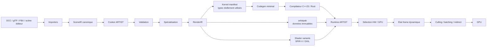
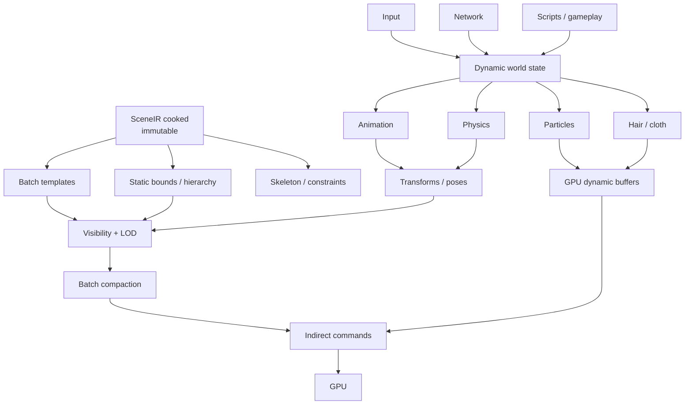

# ARTIST : jusqu’où compiler une scène 3D en code statique pour viser l’excellence technique ?

## Résumé exécutif

La conclusion centrale de cette recherche est assez nette : **ton intuition de départ est bonne, mais l’unité à spécialiser statiquement ne devrait généralement pas être “l’objet de scène” ; elle devrait être “la classe de comportement” de l’objet.**

Autrement dit :

> **Code statique par comportement. Données compilées par identité. État dynamique par nécessité.**

ARTIST possède déjà une partie de cette philosophie. `Pipeline<API, PROFILE>` et `Pass<API, PROFILE>` utilisent `requires` et `if constexpr` pour sélectionner et valider des composants au moment de la compilation. Mais cette résolution statique est actuellement enveloppée dans des interfaces virtuelles, des `shared_ptr`, des `vector` de pointeurs et des `unordered_map<string,...>`. Le code a donc aujourd'hui un caractère hybride : **sélection statique des algorithmes, représentation dynamique de leur assemblage**. fileciteturn4file0L2-L2 fileciteturn5file0L2-L2 fileciteturn8file0L2-L2

Cela ne signifie pas que les templates ont été « annulés » par les fonctions virtuelles. Clang sait dévirtualiser certains appels, y compris avec LTO et `-fwhole-program-vtables`, et peut transformer certains appels virtuels en appels directs, ce qui ouvre ensuite l'inlining et d'autres optimisations. Le vrai problème est donc moins « il existe un `virtual` quelque part » que **“combien de décisions, d'indirections, de recherches et de déplacements mémoire restent sur le chemin chaud après optimisation ?”** citeturn17search3

À mon avis, une architecture réellement ambitieuse pour ARTIST ne devrait donc **pas** chercher à produire quelque chose comme :

```cpp
void render_scene_00842() {
    draw_cloud_01();
    draw_tree_023();
    draw_tree_024();
    draw_squall();
    draw_rinoa();
    ...
}
```

pour chaque scène.

Elle devrait plutôt générer quelque chose conceptuellement proche de :

```text
Scene source
   ↓
SceneIR canonique
   ↓
Cook / spécialisation
   ├── données compactes et immuables
   ├── batches préclassifiés
   ├── shader variants connus
   ├── recettes PSO connues
   ├── render schedule partiellement résolu
   └── liste MINIMALE des kernels réellement nécessaires
                  ↓
         compilation C++ / Rust
                  ↓
      kernels natifs monomorphisés
```

À l'exécution, tu ne dispatches alors pas un comportement différent pour chaque arbre ou chaque personnage : tu dispatches **une fois pour plusieurs centaines ou milliers d'instances appartenant à la même classe de rendu**.

C'est là que la métaprogrammation devient réellement intéressante.

### La recommandation en une table

| Élément | Compile-time | Cook-time | Runtime |
|---|---:|---:|---:|
| Backend graphique et kernels | **Oui** | Sélection | Dispatch grossier |
| Vertex layouts | **Oui** | Sélection | Non |
| Algorithmes skinning/material | **Oui** | Variantes utilisées | Sélection grossière |
| Graphe de scène/topologie | Non | **Oui** | Lecture |
| Noms → IDs | Non | **Oui** | Jamais dans hot path |
| Material instances | Non | **Oui** | Paramètres dynamiques |
| Shaders | Compilation offline | **Oui** | Chargement |
| Recettes de pipelines | Génériques | **Oui** | Création/cache driver |
| Render graph | Algorithmes | **Majoritairement** | Conditions/extents |
| Transforms | Non | Valeurs initiales | **Oui** |
| Animation | Solver statique | Bindings/squelette | **Pose** |
| Physics | Solver statique | Shapes/contraintes | **Simulation** |
| Cloth/hair | Solver statique | Rest state/contraintes | **Simulation** |
| Particules | Kernel statique | Emitter definition | **Population/état** |
| Culling | Kernel statique | Bounds initiaux | **Oui, idéalement GPU** |
| Input/réseau | Non | Non | **Oui** |
| Streaming | Non | Partitionnement | **Oui** |
| Hot reload | Non | Re-cook incrémental | **Oui, dev** |

La distinction importante est que **cook-time n'est pas runtime**. Une scène conservée sous forme de données n'est pas nécessairement une scène « interprétée ». Elle peut être **compilée en données extrêmement spécialisées**, prétriées et débarrassées de presque toutes les décisions.

Cette architecture hybride a, selon mon analyse, **90 à 98 % du potentiel de performance réaliste d'un scene-to-native-code intégral**, tout en évitant l'essentiel de son explosion de temps de compilation, de taille de binaire, de pression sur le cache d'instructions, de perte de hot-reload et de perte de moddabilité. Cette fourchette est une estimation de conception, pas un benchmark publié ; elle devrait précisément devenir l'une des hypothèses testées par le futur harness ARTIST.

Le gain de l'AOT ne doit par ailleurs pas être confondu avec le gain de la disparition des appels de fonctions. Dans un renderer moderne, les optimisations beaucoup plus importantes sont souvent :

1. supprimer les recherches par chaînes et les graphes de pointeurs dans le hot path ;
2. organiser les données pour les caches ;
3. préclasser les objets par pipeline/material/layout ;
4. éviter les changements d'état ;
5. réduire les commandes CPU→GPU ;
6. faire du culling et de la génération de draws sur le GPU ;
7. préconstruire ou préchauffer les pipelines ;
8. paralléliser efficacement la construction des command buffers.

Khronos montre par exemple qu'un sample Vulkan d'environ **1 800 draw calls** obtient environ **15 % d'amélioration** en répartissant l'enregistrement entre huit buffers et huit threads ; le même sample montre également que l'allocation/libération répétée de command buffers peut absorber **28,8 %** de la capture CPU contre **0,45 %** pour le reset du pool. Ce sont des effets beaucoup plus importants qu'un simple appel de fonction supprimé. citeturn12search9

Même chose pour les pipelines : dans le sample officiel Khronos sur Mali G76, recréer deux pipelines prend **50,4 ms sans cache contre 24,4 ms avec cache**. Ce n'est pas un gain moyen par frame : c'est un problème de **stutter**, et il illustre précisément pourquoi ARTIST devrait connaître ses variants au cook-time et faire du warm-up/cache plutôt que créer des PSO au premier draw. citeturn16search0turn15search11

Enfin, **Rust n'augmente pas intrinsèquement le plafond de performance par rapport à C++23**. Les deux permettent la spécialisation statique, l'inlining, des layouts contrôlés et du code natif sans GC. Rust monomorphise explicitement ses génériques, avec le compromis documenté : code rapide contre temps de compilation et taille de binaire. citeturn14view0

Rust peut toutefois améliorer une autre composante de ton « excellence technique » : **la capacité à maintenir des invariants extrêmement agressifs sans transformer le moteur en champ de mines de lifetime/data-race/use-after-free**. Le système d'ownership est vérifié à la compilation et n'ajoute pas lui-même de mécanisme de gestion mémoire à l'exécution. citeturn13view0

Mais je ne réécrirais pas ARTIST en Rust aujourd'hui pour obtenir de meilleures performances. Je conserverais vraisemblablement :

**runtime ARTIST en C++23 + cooker/compiler de scène potentiellement en Rust**, avec un IR indépendant du langage.

Cela permettrait de mesurer honnêtement C++ contre Rust plus tard, au niveau des quelques kernels qui comptent vraiment, au lieu de payer immédiatement le coût d'une réécriture intégrale.

## État actuel d’ARTIST et diagnostic de la philosophie statique

Le README définit explicitement ARTIST comme une bibliothèque graphique C++23 orientée composition et métaprogrammation, destinée à résoudre les configurations de pipeline à la compilation. Le projet utilise des templates, des concepts/`requires` et des profiles API pour cette spécialisation. Il dépend actuellement de GLM, GLFW, GLEW et OpenGL dans son manifeste Conan. fileciteturn6file0L2-L2 fileciteturn7file0L2-L2

Ta philosophie originelle n'est donc absolument pas un accident architectural. Elle est au cœur du projet.

Le point particulièrement intéressant est ce code conceptuel dans `Pipeline` :

```cpp
template <typename API, auto PROFILE>
    requires(API::Validator::template validatePipeline<API, PROFILE>())
class Pipeline : public IPipeline<API>
{
protected:
    void use(std::shared_ptr<typename API::PipelineContext> context) override
    {
        if constexpr (
            graphic::validator::HasComponent<
                typename API::PipelineContext::User<PROFILE>
            >
        ) {
            API::PipelineContext::template User<PROFILE>::on(context);
        }
    }
};
```

C'est une bonne idée.

`if constexpr` signifie ici que l'existence même du composant est une décision de compilation ; un composant absent n'a pas besoin de laisser une branche runtime. Le `requires` encode également une partie des invariants architecturaux dans le système de types. fileciteturn4file0L2-L2

Mais le trajet menant à cette opération contient encore :

```text
shared_ptr
    ↓
IPipeline virtual
    ↓
Pipeline<API,PROFILE>
    ↓
shared_ptr context
    ↓
component statiquement connu
```

Et dans `Pass`, la même combinaison continue avec des collections de `shared_ptr`, des méthodes virtuelles et des `unordered_map<std::string,...>` pour les uniforms et attributes. fileciteturn5file0L2-L2

`PassContext` matérialise particulièrement bien le contraste :

```cpp
std::vector<std::shared_ptr<IShader<API>>> m_shaders;

std::unordered_map<
    std::string,
    std::shared_ptr<Uniform<API>>,
    ...
> m_uniforms;

std::unordered_map<
    std::string,
    std::shared_ptr<IAttribute<API>>,
    ...
> m_attributes;
```

fileciteturn8file0L2-L2

C'est cette partie que je changerais avant d'envisager un compilateur complet de scènes.

### Pourquoi le `virtual` n'est pas nécessairement ton principal ennemi

Supposons :

- 20 000 appels polymorphiques par frame ;
- 5 à 15 cycles économisés en moyenne par appel après transformation en code direct/inliné ;
- CPU à 4 GHz.

Modèle :

\[
20\,000 \times 5 \dots 15 =
100\,000 \dots 300\,000\ cycles
\]

soit :

\[
0,025 \dots 0,075\ ms
\]

Même avec 100 000 appels, on serait, dans ce modèle extrêmement simplifié, autour de **0,125–0,375 ms**.

Ce n'est pas nul. À 120 Hz, tout compte.

Mais cela montre pourquoi « supprimer tous les function calls » n'est pas nécessairement le premier levier.

Le vrai avantage de la résolution statique est souvent **ce qu'elle autorise après la disparition de l'indirection** :

```text
devirtualization
      ↓
inlining
      ↓
constant propagation
      ↓
dead-code elimination
      ↓
loop simplification
      ↓
vectorization / unrolling
      ↓
meilleure connaissance des alias
```

Clang documente précisément ces optimisations : le Whole Program Devirtualization peut identifier une implémentation unique, et la dévirtualisation spéculative transforme un appel indirect en appel direct protégé par une vérification, ce qui ouvre davantage d'opportunités d'inlining. citeturn17search3

Donc oui : **ta recherche de statique est techniquement légitime**.

Mais il faut mesurer le statique selon cette métrique :

> Combien de décisions et d'accès mémoire supplémentaires le compilateur peut-il réellement supprimer grâce à cette information ?

et non :

> Combien de mots-clés `virtual` puis-je supprimer ?

### Là où ARTIST a probablement aujourd'hui plus à gagner

Une recherche `unordered_map<string,...>` dans une boucle chaude est structurellement plus inquiétante qu'un unique appel virtuel prévisible.

Un graphe constitué de `shared_ptr` est également moins favorable à une traversal massive qu'un ensemble de tableaux contigus. Le Rust Book résume le principe matériel sous-jacent : suivre des pointeurs vers des données dispersées est généralement plus lent que travailler sur des données proches en mémoire, parce que les processeurs tirent profit de la localité. citeturn13view0

Je transformerais donc progressivement :

```cpp
pass.withUniform("cameraViewProjection", matrix);
```

en quelque chose proche de :

```cpp
pass.set<UniformId::CameraViewProjection>(matrix);
```

puis, dans les chemins les plus chauds :

```cpp
frame_uniforms.camera_view_projection = matrix;
```

ou même :

```cpp
upload_frame_block(frame_uniforms);
```

Une chaîne est excellente pendant l'authoring.

Un ID est excellent au chargement.

Un offset connu est meilleur dans le hot path.

Un block contigu téléchargé en une fois est souvent encore meilleur.

Même principe pour le graphe de scène :

```text
Object*
 ├─ Mesh*
 ├─ Material*
 ├─ Transform*
 └─ Renderer*
```

devient, après cook :

```text
Renderable[0..N]
 ├─ mesh_id[]
 ├─ material_id[]
 ├─ transform_index[]
 ├─ bounds[]
 ├─ flags[]
 └─ batch_id[]
```

Il faut alors moins considérer ARTIST comme un système « orienté objets qui s'appellent » et davantage comme **un compilateur de descriptions en flux de données spécialisés**.

C'est, à mon sens, l'évolution naturelle de ta philosophie plutôt que son abandon.

## Frontières entre compile-time, cook-time et runtime

Le point le plus important pour un moteur conçu autour de l'AOT est de ne pas confondre trois moments très différents.



Le **compile-time** est celui du langage hôte. Le **cook-time** est celui où les assets sont connus. Le **runtime** est celui où le joueur et le monde bougent.

Le piège serait d'envoyer au compilateur C++ quelque chose qui peut parfaitement être résolu par le cooker. Cela lie artificiellement la boucle de création de contenu à la boucle de compilation native.

### Ce qui doit être statique dans le code

Je spécialiserais les **algorithmes** et les **contrats de layout** :

| Famille | Bon candidat au code statique |
|---|---|
| Backend | Vulkan / D3D12 / Metal class |
| Géométrie | static / skinned / morph |
| Vertex format | signatures réellement utilisées |
| Material model | PBR / skin / hair / eye / water… |
| Transparency | opaque / alpha-test / transparent |
| Skinning | CPU / compute / vertex shader |
| Lighting path | forward / deferred / clustered… |
| Shadow kernel | none / caster variants |
| Descriptor strategy | bindless / bounded |
| Solver physique | algorithme |
| Cloth/hair solver | algorithme |
| Particle simulation | kernel |
| Culling | CPU / GPU kernel |
| Serialization schema | layout/version |

En C++ :

```cpp
template <
    typename Backend,
    MaterialClass Material,
    GeometryClass Geometry,
    RenderFlags Flags
>
struct DrawKernel final
{
    static ARTIST_FORCE_INLINE
    void record(
        CommandEncoder& encoder,
        std::span<const DrawInstance> instances)
    {
        // Backend, Material, Geometry et Flags sont connus.
        // Le compilateur voit tout le kernel.
        Backend::template bind_pipeline<Material, Geometry, Flags>(encoder);
        Backend::template draw_batch<Geometry>(encoder, instances);
    }
};
```

Ce que je **ne** ferais pas :

```cpp
template <SceneObjectId Id>
struct DrawObject;
```

avec une spécialisation par arbre, caisse ou NPC.

L'objet n'est pas un comportement.

Il est une donnée.

### Ce qui doit être compilé au cook-time

Le cooker connaît des choses que le compilateur du moteur ne connaît pas naturellement, mais qui ne changeront pas pendant une session de jeu :

- hiérarchie et topologie de scène ;
- meshes et références d'assets ;
- material assignments ;
- vertex layouts présents ;
- material feature masks réellement utilisés ;
- squelette et binding des animations ;
- rest poses ;
- collision meshes ;
- contraintes initiales cloth/hair ;
- bounding volumes ;
- LOD topology ;
- dependency graph ;
- noms et chemins d'assets ;
- possibilités connues du render graph ;
- ressources dont les lifetimes peuvent être déterminées ;
- ensemble exact des shader variants utilisés par un niveau.

Le cooker peut alors transformer :

```text
"materials/rinoa_hair"
"skin_albedo"
"uCameraViewProjection"
"mesh_body_lod_2"
```

en :

```text
MaterialId(37)
TextureSlot(2)
UniformOffset(64)
MeshId(812)
```

Il peut également trier les instances :

```text
avant :

tree
rinoa
rock
tree
squall
rock
tree

après :

Batch PBR_STATIC_OPAQUE
  tree
  tree
  tree
  rock
  rock

Batch PBR_SKINNED_OPAQUE
  rinoa
  squall
```

Cela retire des décisions runtime **sans convertir chaque objet en code machine**.

### Ce qui doit rester dynamique

Une scène Final Fantasy n'est pas une démo statique.

Ces données doivent réellement changer :



Input, réseau, game logic, visibilité, occlusion, streaming, pose d'animation, simulations de physique, particules, cheveux et vêtements sont fondamentalement dynamiques.

Mais le **solveur** des cheveux peut être statique.

Les **contraintes de repos** peuvent être cooked.

Le **nombre et le layout des buffers** peuvent être pré-calculés.

Le **state actif** reste dynamique.

C'est une distinction extrêmement importante.

Par exemple :

```text
HairAsset:
    topology               COOK
    rest_lengths           COOK
    collision bindings     COOK
    stiffness coefficients COOK
    solver kernel          COMPILE

HairInstance:
    current positions      RUNTIME
    previous positions     RUNTIME
    velocities             RUNTIME
    contacts               RUNTIME
```

Tu obtiens ainsi presque tout le bénéfice du statique sans faire semblant qu'une simulation est prédictible avant que le joueur lance le jeu.

### Le render graph

Le render graph devrait lui aussi être **partiellement compilé**.

On peut préparer au cook-time :

```text
Depth
  ↓
HZB
  ↓
GPU culling
  ↓
GBuffer
  ↓
Lighting
  ↓
Transparency
  ↓
PostFX
  ↓
UI
```

et dériver :

- dépendances ;
- ordre topologique ;
- possibilités d'aliasing ;
- familles de barriers ;
- ressources transitoires ;
- pass signatures.

Mais l'exécution peut encore dépendre de :

- résolution ;
- swapchain ;
- feature tier GPU ;
- ray tracing on/off ;
- qualité ;
- caméra ;
- présence de transparence ;
- debug overlays ;
- dynamic resolution.

Le bon résultat n'est donc pas un `if` par pass chaque frame.

Il ressemble davantage à :

```cpp
const RenderPlan* plan =
    plan_table[device_profile][quality_profile];

plan->execute(frame);
```

puis les chemins internes au plan sont largement spécialisés.

Autrement dit : **runtime selection once, static execution many times**.

## Options architecturales et comparaison C++23 / Rust

Il existe quatre niveaux raisonnables d'AOT pour ARTIST.

| Architecture | Runtime CPU | I-cache | Build/itération | Hot reload / mods | Complexité | Avis |
|---|---:|---:|---:|---:|---:|---|
| Graphe OO/data-driven runtime | Moyen | Excellent | Excellent | Excellent | Faible | Bon baseline |
| Scène entière → code natif | Potentiellement minimal | **Risque élevé** | Mauvais | Mauvais | Très élevée | Expérimental |
| **Données cooked + kernels statiques** | **Excellent** | **Excellent** | **Bon** | **Bon** | Élevée mais maîtrisable | **Recommandé** |
| Hybride précédent + GPU-driven | **Minimal** | Excellent | Bon | Bon | Très élevée | **Cible long terme** |

Le troisième cas est celui que je choisirais pour ARTIST.

Le quatrième est celui que je viserais ensuite.

Khronos montre pourquoi : Multi-Draw Indirect permet de générer des draws depuis le GPU et de lancer un tableau de draw commands d'un coup, réduisant le travail CPU et les bindings ; le sample officiel déplace également le frustum culling sur le GPU. citeturn19search1

Cela soulève un point fondamental :

> À très haut niveau d'optimisation, le meilleur moyen d'optimiser une fonction CPU de génération de draws n'est parfois pas de l'inliner. C'est de la supprimer.

### Pourquoi le scene-to-code intégral est moins séduisant qu'il n'en a l'air

Imaginons 100 000 nodes.

Le générateur produit :

```cpp
render_node<1>();
render_node<2>();
render_node<3>();
...
render_node<100000>();
```

L'optimiseur pourrait tout connaître.

Mais il doit ensuite produire du code machine.

Si chaque bloc spécialisé finit par occuper, mettons, **128 octets** en moyenne :

\[
100\,000 \times 128 = 12,8 MB
\]

À 256 octets :

\[
25,6 MB
\]

Ce ne sont que des hypothèses de modélisation, mais elles illustrent le problème : tu viens de convertir des données très compactes en **instructions**.

Le moteur équivalent pourrait conserver :

```cpp
struct Renderable {
    uint32_t mesh;
    uint32_t material;
    uint32_t transform;
    uint32_t batch;
};
```

Soit 16 octets par objet dans cet exemple.

100 000 objets :

\[
1,6 MB
\]

Et une simple boucle :

```cpp
for (const auto& item : batch.items)
    process(item);
```

peut être extrêmement efficace parce que le code de la boucle reste petit, tandis que les données sont contiguës.

Le scene-to-code intégral peut donc échanger :

```text
D-cache / data bandwidth
```

contre :

```text
I-cache / instruction bandwidth
```

sans bénéfice algorithmique.

Voilà pourquoi « davantage de code statique » n'est pas monotoniquement égal à « davantage de performance ».

### C++23 contre Rust pour ce design

| Dimension | C++23 | Rust |
|---|---|---|
| Plafond de performance | **Excellent** | **Excellent** |
| Génériques monomorphisés | Templates | Oui, explicitement monomorphisés |
| Métaprogrammation ARTIST actuelle | **Très naturelle** | Faisable mais différente |
| `constexpr` / `consteval` | **Très puissant** | Const evaluation plus contrainte |
| Traits/concepts | Concepts/`requires` | Traits |
| Macros/code generation | Préprocesseur/templates/externe | Proc macros/build.rs/externe |
| Contrôle de layout | Excellent | Excellent avec `repr(...)` |
| Sécurité mémoire | Manuelle/outillée | **Très forte en safe Rust** |
| Data-race prevention | Manuelle/outillée | **Très forte en safe Rust** |
| C++ SDK interop | **Native** | FFI/wrapper |
| Migration ARTIST | **Faible** | **Réécriture** |
| Vulkan/C++ tooling | Très mature | Bon et croissant |
| Physics C++ | **Très riche** | FFI ou moteurs Rust |
| Temps de compilation generics | Peut devenir élevé | Peut devenir élevé |
| Convient à ta philosophie | **Oui** | **Oui** |

Rust documente explicitement que chaque instanciation générique nécessaire devient une version concrète du code ; cette monomorphisation donne des programmes rapides mais augmente compilation et taille du binaire. C'est exactement le même type de compromis que celui que tu cherches consciemment avec ARTIST. citeturn14view0

Rust te permet également de contrôler les représentations mémoire. Sa représentation par défaut ne garantit volontairement que les propriétés nécessaires à la sûreté et peut notamment réordonner les champs ; `#[repr(C)]`, `align` et `packed` permettent au contraire de fixer les propriétés nécessaires aux interfaces binaires et aux structures dont le layout est contractuel. citeturn14view4turn14view5

Donc un runtime très data-oriented est parfaitement naturel :

```rust
#[repr(C)]
pub struct DrawInstance {
    transform_index: u32,
    mesh_index: u32,
    material_index: u32,
    flags: u32,
}

pub struct Kernel<B, const MATERIAL: u32, const FLAGS: u32> {
    _backend: core::marker::PhantomData<B>,
}

impl<B, const MATERIAL: u32, const FLAGS: u32>
    Kernel<B, MATERIAL, FLAGS>
where
    B: Backend,
{
    #[inline(always)]
    pub fn record(
        encoder: &mut B::Encoder,
        instances: &[DrawInstance],
    ) {
        B::bind_pipeline::<MATERIAL, FLAGS>(encoder);
        B::draw_instances(encoder, instances);
    }
}
```

C'est très proche conceptuellement de ton ARTIST actuel.

La question n'est donc pas :

> « Est-ce que Rust peut faire mon architecture statique ? »

La réponse est **oui**.

La vraie question est :

> « Est-ce que Rust apporte suffisamment d'excellence technique supplémentaire pour justifier le coût de migration ? »

Pour l'instant, je répondrais : **pas pour la performance brute**.

Pour la sûreté, c'est différent. Rust vérifie son modèle d'ownership à la compilation sans ajouter de runtime de garbage collection ; c'est une propriété intéressante dans un moteur qui manipulera simultanément GPU resources, jobs, streaming, physics buffers et ownership complexe. citeturn13view0turn20search1

En revanche, son interaction avec le monde C++ n'est pas transparente. La documentation Rust indique explicitement que Rust n'appelle pas directement une bibliothèque C++ via son FFI C standard ; un ABI C ou une couche de binding est nécessaire. citeturn13view1

C'est important pour les middlewares.

Jolt, par exemple, est un moteur physique C++ orienté multithreading et expose directement son intégration CMake côté C++. citeturn11search0

Rust possède de son côté Rapier, moteur de physique 2D/3D écrit en Rust et destiné notamment aux jeux/simulations. citeturn9search2

Et côté graphique, Rust dispose notamment de wgpu, dont le projet fournit une API Rust multiplateforme couvrant plusieurs backends graphiques. citeturn9search1

C++ reste néanmoins le chemin de moindre résistance pour l'écosystème natif auquel ARTIST devra probablement parler.

### Mon choix concret

Je ferais :

```text
ARTIST runtime
    C++23

ARTIST cooker / asset compiler
    Rust OU C++23
    ↓
    langage secondaire acceptable

SceneIR / RenderIR
    langage indépendant

Shaders
    offline compiler

Physics
    Jolt / autre moteur derrière abstraction étroite
    OU solver maison ciblé là où cela a réellement de la valeur
```

Le cooker est précisément l'endroit où Rust aurait énormément de sens :

- parsing d'assets non fiables ;
- transformations parallèles ;
- graphes de dépendances ;
- génération déterministe ;
- beaucoup de données/ownership ;
- pas d'impact FFI runtime ;
- aucune contrainte de micro-latence par frame.

On obtiendrait ainsi une grande partie des avantages techniques de Rust **sans réécrire le runtime ARTIST**.

## Gains mesurables, coût hardware et coût de build

Il faut ici séparer les données réellement mesurées dans la littérature/documentation des estimations de conception.

### Résultats mesurés utiles comme bornes

Le sample Khronos d'enregistrement Vulkan multithreadé utilise environ 1 800 draws et rapporte environ **15 % d'amélioration** avec huit threads/huit command buffers. citeturn12search9

Le même benchmark rapporte :

| Stratégie command buffers | Temps fonctions request/reset | Capture totale | Part CPU |
|---|---:|---:|---:|
| Reset pool | 53,3 ms | 11 877 ms | **0,45 %** |
| Reset individuel | 140,29 ms | 12 087 ms | **1,16 %** |
| Allocate/free | 3 319,25 ms | 11 513 ms | **28,8 %** |

Ces nombres viennent directement du sample Khronos. citeturn12search9

Pour les pipelines :

| Vulkan pipeline creation | Deux pipelines |
|---|---:|
| Avec cache | **24,4 ms** |
| Sans cache | **50,4 ms** |
| Différence | **26,0 ms** |

Ce benchmark a été réalisé dans le sample Khronos sur Mali G76 ; il mesure du pipeline recreation/stutter, pas le frame-time normal. citeturn16search0

Ces deux résultats illustrent quelque chose d'important : **une bonne architecture de soumission et de cache peut produire des gains de plusieurs ordres de grandeur supérieurs au coût isolé d'une virtual call**.

### Modèle ARTIST plausible

Prenons un niveau avec :

```text
10 000 nodes rendables
 4 000 visibles
 1 500 draws CPU avant batching supplémentaire
 CPU ~4 GHz
 objectif 60 Hz = 16,67 ms/frame
```

Le tableau suivant n'est **pas un benchmark ARTIST existant**. C'est une plage de modélisation raisonnable destinée à construire le futur benchmark.

| Étape render CPU | Graphe dynamique classique | Cooked + kernels statiques | Full scene-to-code |
|---|---:|---:|---:|
| Traversal/classification | 0,5–1,5 ms | **0,10–0,35 ms** | 0,05–0,25 ms |
| Material/property resolution | 0,3–1,0 ms | **0,03–0,15 ms** | 0,02–0,10 ms |
| Culling CPU | 0,4–1,2 ms | 0,3–0,9 ms | 0,3–0,9 ms |
| Command construction | 0,7–1,5 ms | **0,4–1,0 ms** | 0,4–1,0 ms |
| Total représentatif | 1,9–5,2 ms | **0,83–2,4 ms** | 0,77–2,25 ms |

Le résultat intéressant n'est pas la valeur absolue.

C'est l'écart :

```text
dynamic graph
      ↓
cooked hybrid

gain potentiel important

cooked hybrid
      ↓
everything-is-code

gain supplémentaire beaucoup plus petit
```

Dans cette modélisation, le passage du graphe dynamique vers le modèle hybride peut économiser **environ 0,8 à 2,8 ms CPU** dans une scène exigeante.

Le passage supplémentaire du modèle hybride vers le code entièrement généré n'économise que **0 à ~0,3 ms**, et pourrait même devenir négatif si la taille de code détériore le cache d'instructions.

C'est exactement l'hypothèse que je chercherais à falsifier expérimentalement.

### Pourquoi l'inlining seul est rarement le jackpot

Modèle de 100 000 dispatches/frame :

```text
100 000 appels
× 10 cycles gagnés
= 1 000 000 cycles
```

À 4 GHz :

\[
1\,000\,000 / 4\,000\,000\,000 = 0,25 ms
\]

Donc même un nombre très élevé d'appels ne produit pas nécessairement plusieurs millisecondes de gain.

En revanche, imaginons seulement 10 000 résolutions de propriétés à **80 ns** chacune dans un modèle avec hashing + pointer chasing :

\[
10\,000 \times 80ns = 0,8ms
\]

La valeur de 80 ns est ici une hypothèse de modélisation, pas une mesure universelle. Le calcul démontre simplement pourquoi **la représentation des données peut peser plus lourd que l'appel de fonction**.

### Cache et prédiction : objectifs de mesure

Il serait trompeur d'annoncer un « L1 hit-rate d'ARTIST » sans le mesurer sur une machine précise.

En revanche, on peut définir des **objectifs de succès**.

| Architecture | L1D hit-rate visé | Branch miss visé | Risque L1I |
|---|---:|---:|---|
| Graphe de pointeurs dynamique | baseline à mesurer | baseline | Faible |
| Packed AoS/SoA + handles | **+5 à +15 points vs baseline** | **-30 à -70 % relatif** | Très faible |
| Kernels monomorphisés par batch | Idem | **Encore inférieur** | Faible |
| Fonction générée par objet | D-cache potentiellement bon | Très faible | **Élevé** |

Ce ne sont pas des prédictions universelles : ce sont les seuils que j'utiliserais pour justifier la complexité.

Par exemple, si un prototype scene-to-code donne :

```text
CPU render     -0,08 ms
L1D misses     -10 %
L1I misses     +180 %
build          ×8
binary         ×4
```

je le rejetterais.

Même s'il est « plus statique ».

À l'inverse :

```text
CPU render     -1,4 ms
branch misses  -65 %
L1D misses     -35 %
build          +15 %
```

serait une excellente justification.

### Impact GPU

AOT-compiler du C++ ne rend pas directement un shader GPU plus rapide.

Si les deux versions envoient exactement :

```text
mêmes draws
mêmes shaders
mêmes buffers
mêmes barriers
mêmes PSO
```

le GPU recevra pratiquement le même travail.

Le gain est alors CPU.

Le GPU commence à bénéficier indirectement de l'architecture si le cooker permet :

- meilleur batching ;
- meilleur ordre des draws ;
- réduction des state changes ;
- formats de données adaptés ;
- meilleure sélection de LOD ;
- render graph mieux planifié ;
- réduction des barriers ;
- compression ;
- GPU-driven culling.

Le sample Khronos Multi-Draw Indirect montre explicitement le principe : les draw calls peuvent être générés sur GPU, plusieurs commandes sont exécutées à partir d'un même tableau, et les ressources peuvent être regroupées pour réduire les rebindings CPU. citeturn19search1

C'est donc là que je pousserais finalement ARTIST.

Pas :

```text
CPU super-template → 5 000 vkCmdDraw*
```

mais plutôt :

```text
compile-time specialized GPU pipeline
              +
cooked scene batches
              +
GPU visibility
              ↓
indirect command buffer
              ↓
quelques submissions
```

### Build times et binary size

La monomorphisation a un coût réel. Rust le documente explicitement : davantage d'instanciations génériques impliquent davantage de code généré, plus de temps de compilation et des binaires plus gros. citeturn14view0

Cargo expose également directement ce compromis : davantage de codegen units améliore le parallélisme de compilation mais peut réduire la qualité du code, tandis que LTO permet une optimisation globale au prix d'un link plus long ; ThinLTO cherche précisément un compromis. citeturn14view2turn14view3

Côté ARTIST, voilà une estimation de planification sur une workstation moderne 16–32 cœurs/NVMe. Ce n'est pas une mesure du repository actuel.

| Changement | Pure data-driven | Hybride recommandé | Full scene-to-code |
|---|---:|---:|---:|
| Modifier une position | <1 s reload | <1 s re-cook | **recompile/link** |
| Modifier un material param | <1 s | <1 s | potentiellement compile |
| Ajouter material variant | runtime | quelques secondes + shader | compile native possible |
| Modifier un kernel moteur | compile | compile | compile |
| Cook scène 10k nodes | ~0,2–5 s | ~0,5–10 s | génération + compile |
| Rebuild scène 10k | 0 | ~1–10 s si registry change | **10–120 s** |
| Release + LTO | moteur seulement | moteur + petits kernels | **minutes possibles** |
| CI multi-plateforme | normal | +10–30 % estimé | ×2–×10 possible |

Le problème du full-AOT n'est pas seulement le temps absolu.

C'est que :

```text
content change
```

devient :

```text
compiler change
```

Tu perds une frontière extrêmement précieuse.

Avec le modèle hybride :

```text
engine source change
    → native compile

scene change
    → cook

shader change
    → shader compile

texture change
    → texture cook
```

Chaque système n'invalide que ce qu'il doit réellement invalider.

C'est techniquement beaucoup plus élégant.

## Toolchain, validation et matrice de risque

Pour réaliser cette architecture sérieusement, ARTIST devient en partie **un compilateur**.

Pas seulement une runtime library.

Il faut donc introduire une représentation intermédiaire stable.

Je verrais :

```text
SourceScene
    ↓
ImporterIR
    ↓
SceneIR
    ↓
OptimizedSceneIR
    ↓
RenderIR
    ↓
Runtime artifacts
```

Le générateur ne devrait jamais générer directement du C++ depuis glTF.

Il faut une frontière :

```cpp
struct SceneIR {
    Span<NodeIR> nodes;
    Span<MeshIR> meshes;
    Span<MaterialIR> materials;
    Span<SkeletonIR> skeletons;
    ...
};
```

Puis :

```cpp
struct RenderBatchIR {
    KernelSignature kernel;
    PipelineSignature pipeline;
    ResourceSignature resources;

    uint32_t first_instance;
    uint32_t instance_count;
};
```

Le backend final produit :

```text
scene.artistpak
kernels.generated.hpp
pipelines.manifest
shaders/
```

### Générer peu de code

Supposons que le niveau possède :

```text
75 000 objets
12 material families
4 geometry families
3 shadow classes
```

Ne génère pas 75 000 kernels.

Le cooker peut découvrir qu'il n'existe finalement que :

```text
31 signatures de pipeline réellement distinctes
```

Il génère alors 31 spécialisations.

```cpp
using K0 = DrawKernel<
    VulkanBackend,
    MaterialClass::Skin,
    GeometryClass::Skinned,
    Flags::ShadowCaster>;

using K1 = DrawKernel<
    VulkanBackend,
    MaterialClass::Hair,
    GeometryClass::Skinned,
    Flags::AlphaTest>;

...
```

et une petite table :

```cpp
constexpr KernelFn kernels[] = {
    &record<K0>,
    &record<K1>,
    ...
};
```

Runtime :

```cpp
for (const CookedBatch& batch : visible_batches) {
    kernels[batch.kernel_id](encoder, batch.instances);
}
```

Oui, il existe encore **un indirect call par batch**.

C'est intentionnel.

Si tu passes de :

```text
4 000 dispatches objets
```

à :

```text
31 dispatches batches
```

l'appel indirect est désormais pratiquement sans importance.

Et chaque kernel conserve l'ensemble des avantages de la spécialisation statique.

C'est ce que j'appellerais de la **granularité de polymorphisme optimale**.

### Shader et pipeline compiler

Le cooker devrait également produire les shader variants en offline.

Mais il faut distinguer :

```text
shader source → SPIR-V/DXIL
```

de :

```text
API pipeline → représentation driver/GPU
```

Vulkan indique que la création des pipelines peut être coûteuse et que les pipeline caches permettent de réutiliser une représentation interne entre exécutions. citeturn15search11

Donc ARTIST devrait connaître au cook-time les pipelines dont il aura probablement besoin, puis les construire/préchauffer dans une phase contrôlée au lieu d'attendre le premier draw. Le sample Khronos recommande précisément la création précoce des pipelines connus et l'utilisation du cache. citeturn16search0

L'architecture :

```text
Cook:
    enumerate PipelineSignature
    compile shader bytecode
    build manifest

Runtime startup/loading:
    inspect GPU
    load compatible cache
    create/warm PSOs

Gameplay:
    zero unexpected pipeline compilation
```

est beaucoup plus réaliste qu'essayer de linker dans l'exécutable une représentation native universelle des PSO.

### Build system

Côté C++ :

```text
CMake
Ninja
Clang/GCC/MSVC
ThinLTO release
optional PGO
```

Côté Rust cooker :

```text
Cargo workspace
incremental dev builds
release optimization pour production cooker
```

Cargo documente l'incremental compilation et la séparation en codegen units ; les profils release désactivent par défaut l'incremental et utilisent un niveau d'optimisation supérieur. citeturn14view3

Le générateur doit être **content-addressed** :

```text
hash(
    importer version,
    asset content,
    target platform,
    quality profile,
    compiler schema
)
```

Ainsi :

```text
asset unchanged
    → no cook

scene topology unchanged
    → no generated native code

material signature unchanged
    → no kernel rebuild

shader unchanged
    → no shader compile
```

Sans cela, l'AOT deviendra rapidement infernal.

### Harness de validation

Je construirais trois implémentations du même RenderIR :

```text
ReferenceExecutor
CookedExecutor
GeneratedExecutor
```

Le premier est volontairement simple et dynamique.

Le second utilise les données packed.

Le troisième utilise le code généré.

Ils produisent tous une trace canonique :

```text
BeginPass(depth)
BindPipeline(17)
BindResourceSet(42)
DrawIndexed(...)
...
EndPass
```

Puis :

```text
trace(reference)
==
trace(cooked)
==
trace(generated)
```

Ce système serait extrêmement puissant.

Parce qu'il permettrait de faire évoluer agressivement l'implémentation sans perdre un oracle de correction.

Pour les builds de performance Vulkan, les validation layers doivent être désactivées pendant la mesure finale : Khronos précise que le mode release et l'absence de validation sont nécessaires pour comparer correctement son sample de command buffers. citeturn12search9

Mais les mêmes scènes tourneraient évidemment avec validation dans la CI de correction.

Je mesurerais systématiquement :

```text
CPU
    frame time
    render thread time
    cycles
    instructions
    IPC
    branch count
    branch misses
    L1D misses
    LLC misses
    L1I misses

Renderer
    visible instances
    batch count
    draw count
    PSO switches
    descriptor updates
    command buffer recording time
    submit time

GPU
    pass timestamps
    occupancy lorsque disponible
    bandwidth counters lorsque disponible
    pipeline statistics

Build
    cold build
    incremental kernel build
    scene recook
    shader rebuild
    link time
    binary .text
```

Une optimisation ARTIST ne serait acceptée que si elle améliore ces chiffres.

Pas parce que son template est beau.

Cela correspond exactement à ta définition de l'excellence technique.

### Matrice de risque

| Risque | Probabilité | Impact | Réponse |
|---|---|---|---|
| Explosion de variants | Haute | Haute | Spécialiser par classe, pas objet |
| I-cache dégradé | Haute en full-AOT | Haute | Budget `.text`, benchmark L1I |
| Build times explosifs | Haute | Haute | Cooker séparé, codegen minimal |
| Debugging code généré | Moyenne | Haute | IR dump + source maps |
| Bugs du compiler/cooker | Moyenne | Haute | Executor différentiel |
| Perte hot reload | Haute full-AOT | Haute | Packed data + path dev |
| Perte moddabilité | Haute full-AOT | Haute | Packs externes |
| PSO stutter | Haute sans warmup | Haute | Manifest + cache |
| Architecture benchmarkée sur un seul GPU | Moyenne | Haute | Hardware matrix |
| Port Rust prématuré | Haute | Haute | Benchmark kernel first |
| FFI Rust/C++ complexe | Moyenne | Moyenne | Frontières C étroites |
| Sur-optimisation des virtual calls | Haute | Moyenne | Profile optimized binary |
| Cartesian product de templates | Haute | Haute | Générer uniquement variants utilisés |
| CI trop lente | Moyenne | Haute | Cache artifacts + tiers CI |
| Couplage content/native build | Haute full-AOT | Haute | Ne pas mettre identité en code |

Il y a notamment une ironie importante : **le full scene-to-code peut être moins techniquement excellent que l'architecture hybride**, même s'il paraît plus « hardcore ».

Parce que l'excellence technique doit inclure :

```text
performance
+ déterminisme
+ architecture
+ correctness
+ tooling
+ observabilité
+ coût d'itération
```

et pas uniquement :

```text
nombre minimal d'instructions dans un microbenchmark
```

## Architecture recommandée et feuille de route sur quatre-vingt-dix jours

Ma cible ARTIST serait donc celle-ci :

```text
                         ARTIST
                           │
             ┌─────────────┴─────────────┐
             │                           │
      ARTIST Compiler             ARTIST Runtime
             │                           │
      SceneIR / RenderIR          kernels C++23
             │                           │
        specialization            static dispatch
             │                           │
      ┌──────┼───────┐                   │
      │      │       │                   │
   assets   PSO    kernel                │
    pack  manifest manifest              │
      │      │       │                   │
      └──────┴───────┴─────────┬─────────┘
                               │
                        Runtime scene
                               │
                      dynamic state SoA
                               │
              animation / physics / cloth
                               │
                     GPU visibility
                               │
                       indirect draws
                               │
                              GPU
```

Le mantra serait :

> **Spécialiser le comportement. Compiler les décisions. Compacter les données. Garder l'état dynamique.**

### Ce que je modifierais concrètement dans ARTIST

Premièrement, je ne supprimerais pas brutalement toutes les interfaces actuelles.

Je créerais deux niveaux :

```text
Authoring / generic API
    flexible
    strings
    handles
    polymorphism acceptable

Execution API
    dense IDs
    spans
    arenas
    immutable descriptors
    static kernels
```

`IPipeline` peut survivre dans un outil ou un chemin froid.

Ce que je ne veux pas, c'est :

```text
visible object
    → virtual renderer
    → shared_ptr material
    → unordered_map<string, uniform>
    → virtual pass
    → virtual shader
```

mille fois par frame.

Le shipping path devrait plutôt ressembler à :

```cpp
struct CookedBatch
{
    uint16_t kernel_id;
    uint16_t pipeline_id;

    uint32_t first_instance;
    uint32_t instance_count;
};

void render(const Frame& frame)
{
    for (const auto& batch : frame.visible_batches)
    {
        kernel_table[batch.kernel_id](
            frame.encoder,
            frame.instances.subspan(
                batch.first_instance,
                batch.instance_count));
    }
}
```

Et éventuellement, plus tard :

```cpp
gpu_cull_and_generate_indirect(...);
encoder.draw_indexed_indirect_count(...);
```

Khronos présente justement cette réduction du travail CPU et du nombre de bindings comme l'intérêt du rendu GPU-driven/multi-draw indirect. citeturn19search1

### Les quatre-vingt-dix jours

**Jours 1–14 — établir la vérité.**

Ne pas commencer par écrire le compiler de scène.

Créer d'abord le benchmark qui pourra tuer l'idée si elle est mauvaise.

Trois scènes synthétiques :

| Scène | Nodes | Materials | Draw candidates |
|---|---:|---:|---:|
| Small | 1 000 | 20 | ~500 |
| Medium | 10 000 | 100 | ~5 000 |
| Stress | 100 000 | 500 | ~50 000 |

Trois executors :

```text
Dynamic
Cooked
Generated
```

Un Null/Trace backend retire le GPU de l'équation.

Mesurer :

```text
virtual vs direct
shared_ptr vs arena handle
unordered_map<string> vs ID
AoS vs SoA
dynamic graph vs baked batches
one-dispatch-per-object vs per-batch
```

**Budget : 0,35–0,5 personne-mois.**

À la fin de cette phase, tu dois déjà connaître la réponse à l'une des questions les plus importantes de toute l'architecture :

> Le codegen par objet apporte-t-il quelque chose une fois les données proprement cooked et batchées ?

Je soupçonne que la réponse sera : **très peu**.

Mais je voudrais que ARTIST le prouve.

**Jours 15–35 — SceneIR et cooker.**

Construire :

```text
Importer
 ↓
SceneIR
 ↓
Validation
 ↓
Canonicalization
 ↓
CookedScene
```

Introduire :

```text
AssetId
MeshId
MaterialId
PipelineId
KernelId
TransformId
```

et éliminer les strings du runtime chaud.

Créer :

```text
.artistpak
```

avec offsets relatifs/handles plutôt que graphes de pointeurs.

**Budget : 0,6–0,8 personne-mois.**

Je considérerais sérieusement Rust pour ce programme spécifique. Non pour accélérer le renderer, mais parce qu'un compiler d'assets est un excellent endroit pour profiter de l'ownership et de la sûreté mémoire sans introduire de FFI dans la frame loop. Rust vérifie ces règles à la compilation sans garbage collector runtime. citeturn13view0turn20search1

**Jours 36–55 — kernels statiques et codegen minimal.**

Créer une signature :

```cpp
struct KernelSignature {
    BackendClass backend;
    GeometryClass geometry;
    MaterialClass material;
    LightingClass lighting;
    uint32_t flags;
};
```

Le cooker déduplique :

```text
75 000 objects
→ 40 000 visible candidates
→ 420 batches
→ 37 kernel signatures
```

et génère uniquement 37 kernels.

Tester :

```text
37 generated kernels
vs
75 000 generated object functions
```

Mesurer taille `.text`, L1I, temps compile, runtime.

**Budget : 0,5–0,7 personne-mois.**

**Jours 56–70 — pipeline/shader compiler et soumission moderne.**

Construire le manifest des variants.

Compiler les shaders offline.

Préparer PSO warming/cache.

Ajouter soit :

- un thin Vulkan backend ;
- soit un prototype Vulkan isolé relié au RenderIR.

ARTIST utilise aujourd'hui explicitement GLFW/GLEW/OpenGL dans son manifeste, donc cette étape constitue un travail supplémentaire plutôt qu'une simple modification de configuration. fileciteturn7file0L2-L2

Mesurer command recording.

Le benchmark Khronos suggère que ce domaine mérite beaucoup d'attention : son workload d'environ 1 800 draws gagne ~15 % avec enregistrement multithreadé, et sa gestion de command pools fait varier très fortement le coût CPU. citeturn12search9

**Budget : 0,5–0,75 personne-mois.**

**Jours 71–82 — GPU-driven vertical slice.**

Un pipeline :

```text
Cooked instances
      ↓
GPU bounds
      ↓
compute culling
      ↓
draw command compaction
      ↓
multi-draw indirect
```

Pas besoin de construire tout le moteur GPU-driven.

Il suffit d'une vertical slice permettant de savoir si la prochaine année d'ARTIST doit optimiser davantage le CPU renderer ou déplacer davantage de travail sur le GPU.

Le mécanisme est directement aligné sur le sample Khronos qui utilise indirect draw generation et GPU frustum culling pour réduire le travail CPU. citeturn19search1

**Budget : 0,35–0,5 personne-mois.**

**Jours 83–90 — duel C++23 / Rust.**

À ce moment seulement, choisir deux ou trois kernels réellement coûteux.

Exemple :

```text
culling
animation pose propagation
batch generation
particle update
```

Implémenter exactement le même algorithme et le même layout :

```text
C++23
Rust
```

Comparer :

```text
cycles
instructions
branch misses
cache misses
generated assembly
binary size
compile time
developer complexity
safety invariants
```

Avec Rust, utiliser des generics monomorphisés ; avec C++, templates/concepts. Rust monomorphise les types génériques et accepte explicitement le compromis compile-time/binary-size ; C++/Clang peut de son côté profiter du LTO et de la dévirtualisation globale. citeturn14view0turn17search3

Et **seulement sur cette base** décider s'il existe une justification technique pour migrer davantage du runtime.

**Budget : 0,2–0,3 personne-mois.**

### Ressources globales

Pour un développeur expérimenté travaillant principalement sur ARTIST :

| Travail | Estimation |
|---|---:|
| Harness/perf oracle | 0,4 PM |
| SceneIR/cooker | 0,7 PM |
| Packed runtime | 0,4 PM |
| Kernel codegen | 0,5 PM |
| Pipeline/shader tooling | 0,4 PM |
| Vulkan vertical slice | 0,4 PM |
| GPU-driven prototype | 0,35 PM |
| C++/Rust comparison | 0,25 PM |
| **Total** | **~3,0 PM** |

Trois mois représentent justement environ trois personne-mois pour une personne à temps plein.

C'est donc faisable comme **programme de recherche architecturale** en quatre-vingt-dix jours.

Ce n'est pas assez pour produire tout ton moteur FFVIII.

C'est largement assez pour prendre la décision fondamentale sur laquelle construire les années suivantes.

Côté infrastructure, je prévoirais au minimum :

```text
Workstation principale
    16–32 CPU cores
    64 GB RAM
    NVMe
    GPU principal moderne

Machine/GPU secondaire
    architecture GPU différente

CI
    Linux clang
    Windows clang-cl/MSVC
    debug correctness
    optimized benchmark
    sanitizer configurations

Perf CI
    hardware fixe
    fréquence/power profile contrôlé
    release only
```

Le besoin essentiel n'est pas un énorme cloud.

C'est **du hardware stable et reproductible**.

Les comparaisons de performance Vulkan doivent notamment isoler les effets du mode debug et des validation layers ; Khronos précise lui-même que ceux-ci influencent sensiblement les résultats de son sample. citeturn12search9

### Le verdict final sur ta philosophie

Je ne chercherais pas à « calmer » ta volonté de métaprogrammation.

Je la rendrais plus radicale, mais également plus précise.

Je passerais de :

> **« Le plus de choses possible doivent être du code statique. »**

à :

> **« Toute décision qui peut être éliminée avant le runtime doit être éliminée, par le mécanisme le moins coûteux qui permette de l'éliminer. »**

Parfois ce mécanisme sera `constexpr`.

Parfois `if constexpr`.

Parfois un template.

Parfois une monomorphisation Rust.

Parfois le cooker.

Parfois un simple tableau déjà trié.

Parfois un ID de 16 bits.

Parfois une pipeline cache.

Et parfois la meilleure optimisation consistera à ne plus exécuter l'opération sur le CPU du tout.

C'est cette dernière formulation qui me semble correspondre à ton objectif d'**excellence technique**, plutôt qu'à une orthodoxie « static-first ».

Pour ARTIST, je matérialiserais cette philosophie ainsi :

```text
                         INFORMATION
                              │
             ┌────────────────┼────────────────┐
             │                │                │
        connue en build   connue au cook   inconnue avant frame
             │                │                │
             ▼                ▼                ▼
       COMPILE-TIME       COOK-TIME         RUNTIME
             │                │                │
      templates/types    IR/IDs/batches     state buffers
      algorithms         topology           input/network
      layouts            variants           animation
      invariants         assets             physics
             │                │                │
             └───────────┬────┴────┬───────────┘
                         │         │
                    static kernels │
                         │         │
                         └────┬────┘
                              ▼
                      GPU-driven execution
```

Et ma règle de conception serait :

**statique par comportement, cooked par identité, dynamique par état.**

C'est également ce qui rend la réponse à la question C++23/Rust beaucoup moins dramatique. Les deux langages savent réaliser cette architecture. Rust monomorphise ses génériques et donne des garanties de sûreté particulièrement fortes ; C++23 correspond déjà directement à la structure métaprogrammée d'ARTIST et évite une migration coûteuse. citeturn14view0turn13view0

Je conserverais donc **C++23 pour le runtime à ce stade**, je supprimerais progressivement les indirections inutiles du hot path, je construirais un **SceneIR/RenderIR + cooker**, et je générerais uniquement les **classes de kernels réellement utilisées**.

Le passage complet d'ARTIST à Rust représenterait, selon la taille encore relativement contenue du projet visible aujourd'hui mais compte tenu du caractère architectural de la réécriture, environ **3 à 6 personne-mois** pour retrouver une fondation comparable, la durcir, recréer les intégrations et obtenir des benchmarks crédibles. C'est une estimation de projet, pas une mesure. Le gain attendu en performance native brute serait probablement proche de zéro en moyenne si algorithmes, layouts et backend sont identiques ; le gain potentiel serait surtout dans les **garanties de correction, l'ownership et la concurrence**. Rust lui-même revendique ces garanties sans GC/runtime de gestion mémoire, tandis que sa monomorphisation conserve le modèle de spécialisation statique recherché ici. citeturn20search1turn14view0

Le full scene-to-code, lui, mérite absolument d'être prototypé — **pas parce que je pense qu'il gagnera**, mais parce que ton projet ARTIST est précisément le bon endroit pour mesurer jusqu'où cette idée tient devant le hardware réel.

Et le résultat le plus techniquement intéressant pourrait être de découvrir que la forme optimale n'est ni un moteur classique entièrement data-driven, ni un gigantesque programme généré, mais quelque chose entre les deux :

```text
               compilation statique agressive
                         des kernels
                              +
                 compilation AOT des données
                         par le cooker
                              +
                 état runtime ultra-compact
                              +
                    exécution GPU-driven
```

C'est, parmi les architectures étudiées, celle qui offre à mon sens le meilleur rapport entre **plafond de performance, qualité du code machine, localité, taille du working set, temps de build, itération et capacité à démontrer objectivement l'excellence technique**.